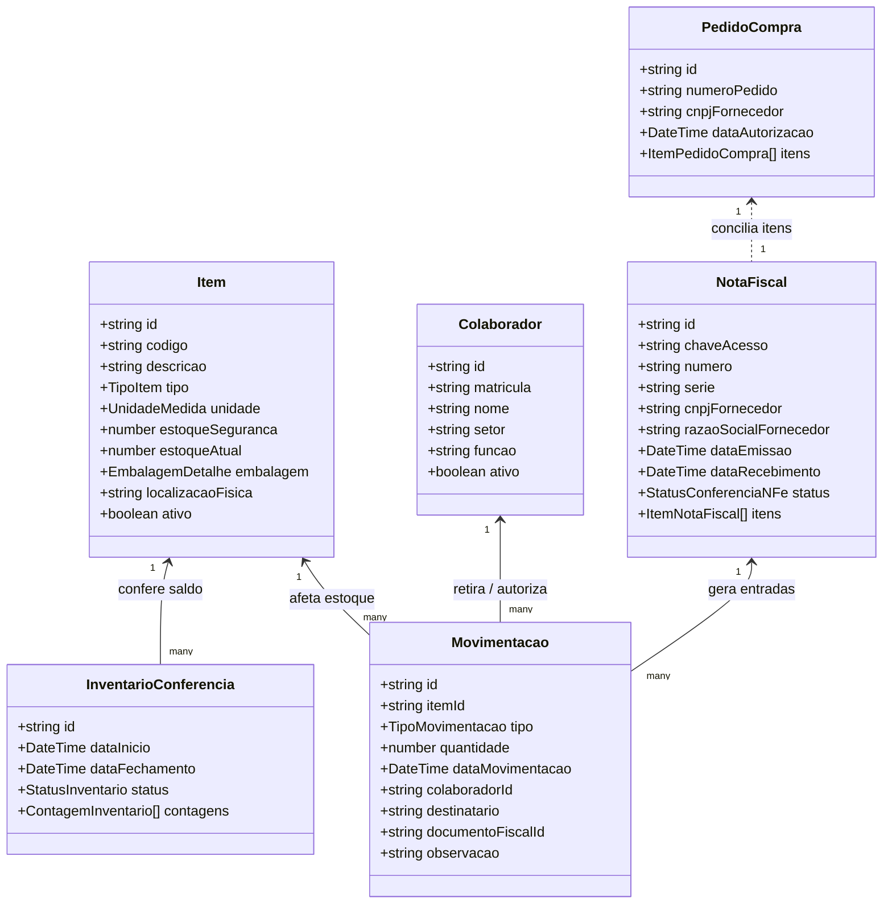

# Plano de Implementação da Lógica Agnóstica (Core Domain)

> **Documento de Engenharia de Software e Especificação de Domínio**  
> **Sistema de Gestão de Almoxarifado Industrial**  
> **Status:** Aprovado para Desenvolvimento  
> **Arquitetura Alvo:** Clean Architecture / Hexagonal — Core Agnóstico Desacoplado (`src/core`)

---

## 1. Visão Geral e Alinhamento Estratégico

Este plano detalha o roteiro de implementação da **lógica agnóstica** (`src/core`) do Sistema de Almoxarifado, projetado a partir da análise dos seguintes insumos corporativos:

1. **Documento de Arquitetura (`docs/arquitetura.txt`)**: Estabelece a separação rígida entre a inteligência da aplicação (*Core Agnóstico*) e a camada de apresentação (*Next.js Web* e futuro *Mobile Expo*), com zero dependência de APIs do navegador (`window`, `document`, `localStorage`) ou componentes de UI.
2. **Proposta de Sistema (`docs/Proposta_Sistema_Almoxarifado.docx`)**: Mapeia as dores reais da operação fabril — lentidão e interrupções nas baixas de materiais, risco de erros em conferências manuais, fluxo burocrático de conferência de NFe com pedidos de compra da contabilidade e organização manual de arquivos por data.
3. **Planilhas Operacionais Atuais (`docs/excel/`)**:
   - `Cont. de Estoque Disco Flap, Mat. de Solda e Brocas.xlsx`: Materiais improdutivos e consumíveis de fábrica (código prefixo `90-XXXX`), estoque de segurança, tabela de colaboradores/setores e histórico de saídas internas.
   - `CONTROLE_PEÇAS 2026_ALMOXARIFADO_ATUALIZADA.xlsx`: Materiais acabados e pronta entrega (código prefixo `100-XXXX`), vínculo com clientes/destinos (Grajau Motos, Galpão Matriz, Shaman), expedições e saldos.
   - `ESTOQUE 2026.xlsx`: Matéria-prima produtiva pesada (tubos NBR/SAE com prefixo `10-XXX`), unidade em KG/Metros, inventários mensais e lançamentos diários de entrada/saída.

---

## 2. Matriz de Transformação: Planilhas Legadas vs. Entidades do Core

A tabela abaixo demonstra como os dados e as dinâmicas manuais das planilhas são mapeados para entidades e serviços tipados no Core Agnóstico:

| Fonte Legada | Estrutura na Planilha | Entidade / Módulo no Core (`src/core`) | Regra de Negócio Implementada |
| :--- | :--- | :--- | :--- |
| **Flap, Solda e Brocas** | `Tabela de Ítens` (Cód `90-XXXX`, Estoque Segurança, Unidade, Utilização) | `src/core/domain/item.schema.ts` (`TipoItem = 'IMPRODUTIVO'`) | Validação de estoque mínimo; controle de embalagem (unidade avulsa vs. pacote c/ N unidades). |
| **Flap, Solda e Brocas** | `Tabela de Colaboradores` (Cód `001-999`, Nome, Setor, Função) | `src/core/domain/colaborador.schema.ts` | Identificação do operador retirante para rastreabilidade de consumo e centro de custo. |
| **Flap, Solda e Brocas** | Aba `Saída` (Data, Cód Colaborador, Cód Item, Quantidade) | `src/core/domain/movimentacao.schema.ts` (`TipoMovimentacao = 'SAIDA_CONSUMO_INTERNO'`) | Baixa atômica de estoque por colaborador sem travar outras operações da fábrica. |
| **Peças Acabadas** | Aba `Geral` e `Tabela de Ítens` (Cód `100-XXXX`, Cliente, Pronta Entrega) | `src/core/domain/item.schema.ts` (`TipoItem = 'ACABADO'`) | Saldo disponível para expedição, controle de clientes habituais e status de lote. |
| **Peças Acabadas** | Aba `SAIDA` (Cód Produto, Quantidade, Destinatário/Cliente, NF, Status) | `src/core/domain/movimentacao.schema.ts` (`TipoMovimentacao = 'SAIDA_EXPEDICAO'`) | Baixa de produto acabado vinculada a cliente/filial e registro de NFe de remessa/venda. |
| **Estoque 2026** | Abas mensais (`JANEIRO` a `OUTUBRO`) em KG com colunas diárias `1` a `31` | `src/core/domain/inventario.schema.ts` e `src/core/services/estoque.service.ts` | Fechamento mensal de saldo em KG, consolidação temporal e inventário físico cíclico. |
| **Processo NFe** | Pastas físicas/digitais por dia de chegada, conferência manual c/ pedido de compra | `src/core/domain/nfe.schema.ts` e `src/core/services/nfe-reconciliation.service.ts` | Conciliação de itens faturados vs. itens autorizados no pedido, tolerâncias e arquivamento por data. |

---

## 3. Arquitetura do Domínio Agnóstico



---

## 4. Fases de Implementação em Pequenas Alterações

A execução está fatiada em **5 Fases Sequenciais**, com **micro-tarefas atômicas** (PRs pequenos) que garantem rastreabilidade, testabilidade e estabilidade contínua.

---

### Fase 1: Fundação de Tipos, Enums e Schemas Zod de Domínio Base
> **Objetivo:** Estabelecer o vocabulário ubíquo do almoxarifado em schemas Zod puros, com validações de dados rigorosas e sem dependências de UI.

#### Micro-tarefas da Fase 1:
- [x] **1.1 — Enums e Tipos Globais (`src/core/domain/types.ts`)**:
  - Definir `TipoItem` (`PRODUTIVO_MATERIA_PRIMA`, `IMPRODUTIVO_CONSUMIVEL`, `ACABADO`).
  - Definir `UnidadeMedida` (`KG`, `UNIDADE`, `METRO`, `PACOTE`, `PECA`, `LITRO`).
  - Definir `TipoMovimentacao` (`ENTRADA_COMPRA`, `ENTRADA_PRODUCAO`, `SAIDA_CONSUMO_INTERNO`, `SAIDA_EXPEDICAO`, `AJUSTE_INVENTARIO_POSITIVO`, `AJUSTE_INVENTARIO_NEGATIVO`).
  - Definir `StatusEstoque` (`NORMAL`, `ESTOQUE_BAIXO`, `CRITICO_ZERADO`).
  - Definir `StatusConferenciaNFe` (`RECEBIDA`, `EM_CONFERENCIA`, `DIVERGENTE`, `APROVADA`, `ARQUIVADA`).
- [x] **1.2 — Schema do Item de Almoxarifado (`src/core/domain/item.schema.ts`)**:
  - Modelar código com validação regex (ex.: aceitar `10-XXX`, `90-XXXX`, `100-XXXX`).
  - Regra de conversão de embalagem (fator multiplicador se o item for comprado em pacote e consumido em unidades).
  - Schemas para listagem, criação e atualização de itens.
- [x] **1.3 — Schema de Colaboradores e Setores (`src/core/domain/colaborador.schema.ts`)**:
  - Mapear matrícula (`001` a `999`), nome completo, setor fabril (Ferramentaria, Qualidade, Logística, Cadeira, Montagem, Solda) e cargo.
- [x] **1.4 — Formatadores Puros de Domínio (`src/core/utils/formatters.ts`)**:
  - Normalizador de código de produto.
  - Formatador de peso em KG (duas casas decimais) e quantidades inteiras para unidades.
  - Sanitizador de números de NF e chaves de acesso.
- [x] **1.5 — Testes Unitários de Schemas (`src/core/domain/__tests__/domain.spec.ts`)**:
  - Testar parsing de itens válidos e rejeição de itens sem código ou quantidade negativa.

---

### Fase 2: Motor de Movimentação e Cálculo Reativo de Saldos
> **Objetivo:** Implementar as regras de entrada, baixa rápida e auditoria de saldo, eliminando a manutenção manual de planilhas.

#### Micro-tarefas da Fase 2:
- [x] **2.1 — Schema de Movimentações (`src/core/domain/movimentacao.schema.ts`)**:
  - Schema de entrada (`itemId`, `quantidade`, `numeroNF`, `fornecedor`, `numeroPedidoRhowert`, `observacoes`).
  - Schema de baixa interna (`itemId`, `quantidade`, `colaboradorId`, `setor`, `observacao`).
  - Schema de saída de expedição (`itemId`, `quantidade`, `clienteDestino`, `numeroNF`, `status`).
- [x] **2.2 — Regras Puras de Estoque (`src/core/services/estoque-calculator.ts`)**:
  - Função pura `calcularNovoSaldo(saldoAtual: number, movimentacao: Movimentacao): number`.
  - Função pura `determinarStatusEstoque(saldoAtual: number, estoqueSeguranca: number): StatusEstoque`.
  - Validação estrita: impedir saídas que resultem em saldo negativo (ou emitir aviso configurável conforme política da fábrica).
- [x] **2.3 — Serviço de Movimentação (`src/core/services/movimentacao.service.ts`)**:
  - Validação completa antes da persistência (verificar se colaborador está ativo e se o item existe).
  - Orquestração de baixa rápida em lote (para quando o colaborador retira broca + disco flap + bico de contato de uma só vez).
- [x] **2.4 — Contrato de Repositório de Estoque (`src/core/storage/estoque.repository.interface.ts`)**:
  - Interface com métodos assíncronos: `buscarPorCodigo`, `listarComFiltros`, `registrarMovimentacao`, `consultarExtratoItem`.
- [x] **2.5 — Custom Hooks Agnósticos (`src/core/hooks/useMovimentacao.ts`)**:
  - Hooks com TanStack Query para mutação de entrada e saída rápida com invalidação de cache atômica.

---

### Fase 3: Módulo de Conferência, Balanço e Inventário Físico
> **Objetivo:** Automatizar o processo que hoje é feito na planilha `ESTOQUE 2026.xlsx` (fechamento mensal e contagens diárias), com histórico de auditoria e rastreio de perdas/sobras.

#### Micro-tarefas da Fase 3:
- [x] **3.1 — Schema de Inventário e Contagem (`src/core/domain/inventario.schema.ts`)**:
  - Definição de sessão de inventário (geral, por setor ou por tipo de material).
  - Schema de contagem física (`itemId`, `saldoSistema`, `quantidadeContada`, `dataHoraContagem`, `responsavelContagemId`).
- [x] **3.2 — Serviço de Apuração de Divergências (`src/core/services/inventario.service.ts`)**:
  - Cálculo de divergência: `diferenca = contagemFisica - saldoSistema`.
  - Classificação de acurácia do estoque (percentual de acurácia global).
  - Geração automática de movimentações compensatórias do tipo `AJUSTE_INVENTARIO`.
- [x] **3.3 — Fechamento Periódico de Saldo (`src/core/services/fechamento-mensal.service.ts`)**:
  - Mecanismo que consolida o saldo final de um mês como inventário inicial do mês subsequente (substituindo a transição manual entre abas de mês da planilha).
- [x] **3.4 — Custom Hooks de Inventário (`src/core/hooks/useInventario.ts`)**:
  - Hook para iniciar contagem, registrar itens bipados/contados e emitir relatório de divergências.

---

### Fase 4: Conciliação de Notas Fiscais (NFe) e Pedidos de Compra
> **Objetivo:** Solucionar o fluxo da contabilidade descrito na proposta: comparar itens da NFe contra o pedido de compra, validar divergências e gerar entradas de estoque sem digitação redundante.

#### Micro-tarefas da Fase 4:
- [x] **4.1 — Schemas de NFe e Pedido de Compra (`src/core/domain/nfe.schema.ts`)**:
  - Mapeamento dos itens faturados (código do fornecedor, código interno Rhowert, NCM, quantidade faturada, valor unitário).
  - Schema de Pedido de Compra emitido pela contabilidade (itens autorizados e quantidades contratadas).
- [x] **4.2 — Algoritmo Puro de Reconciliação (`src/core/services/nfe-reconciliation.service.ts`)**:
  - Cruzamento de itens: `NFe.item` vs `PedidoCompra.item`.
  - Detecção de inconsistências:
    - Quantidade faturada a maior que o pedido.
    - Preço divergente além da margem de tolerância.
    - Itens na nota que não constam no pedido.
  - Determinação do status da NFe (`APROVADA_TOTAL`, `APROVADA_COM_DIVERGENCIA`, `REJEITADA`).
- [x] **4.3 — Workflow de Efetivação de Entrada por NFe (`src/core/services/nfe-entrada.service.ts`)**:
  - Conversão direta dos itens aprovados na NFe em movimentações do tipo `ENTRADA_COMPRA`, atualizando instantaneamente os saldos dos itens.
- [ ] **4.4 — Gestor de Metadados de Arquivamento (`src/core/services/nfe-archive.service.ts`)**:
  - Padronização do caminho de arquivamento virtual por data de recebimento (`AAAA/MM/DD/CHAVE_NFE`), atendendo à necessidade da fábrica de histórico organizado.

---

### Fase 5: Store Global Agnóstica, Cache Offline e Otimizações de Chão de Fábrica
> **Objetivo:** Prover suporte a operações ultra-rápidas no celular/desktop através de estado global agnóstico (Zustand), persistência configurável e preparação para leitor de código de barras.

#### Micro-tarefas da Fase 5:
- [ ] **5.1 — Store de Baixa Rápida / "Carrinho de Retirada" (`src/core/store/useBaixaRapidaStore.ts`)**:
  - Armazenamento em memória do operador selecionado e lista de itens adicionados para baixa simultânea.
  - Permite ao almoxarife escanear múltiplos itens antes de confirmar a entrega final.
- [ ] **5.2 — Adaptador de Persistência em Memória/Cache (`src/core/storage/memory-storage.adapter.ts`)**:
  - Implementação de fallback do `IStorageAdapter` para execução de testes unitários ou ambientes offline sem storage de navegador.
- [ ] **5.3 — Interceptadores e Injeção de Dependência (`src/core/api/client.ts`)**:
  - Configuração de interceptadores HTTP com injeção do token de autenticação via adaptador.
- [ ] **5.4 — Suite de Testes de Integração do Core (`src/core/__tests__/fluxo-completo.spec.ts`)**:
  - Teste ponta a ponta sem UI: Criação de item -> Entrada por NFe -> Baixa por colaborador -> Conferência de inventário -> Apuração de saldo final.

---

## 5. Estrutura de Arquivos Resultante em `src/core`

```text
src/core/
├── api/
│   ├── client.ts                      # Cliente HTTP com interceptadores injetáveis
│   └── endpoints.ts                   # Constantes de rotas da API
├── domain/
│   ├── types.ts                       # Enums e tipos fundamentais
│   ├── item.schema.ts                 # Schemas Zod de Itens (produtivo, improdutivo, acabado)
│   ├── colaborador.schema.ts          # Schemas Zod de Colaboradores e Setores
│   ├── movimentacao.schema.ts         # Schemas de Entradas, Baixas e Saídas
│   ├── nfe.schema.ts                  # Schemas de Nota Fiscal e Pedido de Compra
│   └── inventario.schema.ts           # Schemas de Contagem e Fechamento
├── services/
│   ├── estoque-calculator.ts          # Funções puras de cálculo e status de reposição
│   ├── movimentacao.service.ts        # Regras de negócio de baixa e entrada
│   ├── nfe-reconciliation.service.ts  # Algoritmo de cruzamento NFe x Pedido
│   ├── nfe-archive.service.ts         # Organização e indexação de notas por data
│   └── inventario.service.ts          # Apuração de divergências e balanço
├── storage/
│   ├── storage.interface.ts           # IStorageAdapter para desacoplamento de plataforma
│   ├── estoque.repository.interface.ts# Contrato agnóstico de dados de estoque
│   └── memory-storage.adapter.ts      # Implementação em memória para testes e fallback
├── store/
│   ├── useAppStore.ts                 # Estado global geral (sessão e contexto)
│   └── useBaixaRapidaStore.ts         # Estado do carrinho de retirada rápida no chão de fábrica
├── hooks/
│   ├── useItensEstoque.ts             # TanStack Query para catálogo e saldo
│   ├── useMovimentacao.ts             # TanStack Query para lançamentos de entrada/baixa
│   ├── useNFeReconciliation.ts        # TanStack Query para fluxo de notas
│   └── useInventario.ts               # TanStack Query para sessões de contagem
└── utils/
    ├── formatters.ts                  # Formatadores de código, NFe, datas e pesos
    └── validators.ts                  # Validadores auxiliares de domínio
```

---

## 6. Critérios de Conclusão e Governança

1. **Agnosticismo Estrito:**
   - Nenhum arquivo dentro de `src/core` deve importar `@/web`, `react-dom`, bibliotecas nativas de UI ou usar `window` / `localStorage` diretamente.
   - Qualquer necessidade de persistência ou notificação do dispositivo deve passar por contratos em `src/core/storage/`.
2. **Cobertura por Testes Unitários:**
   - Toda regra de cálculo de estoque e algoritmo de conciliação de NFe deve possuir cobertura com testes em Jest/Vitest/Node runner sem inicializar navegador.
3. **Prontidão Multiplataforma:**
   - A camada `src/core` concluída poderá ser consumida imediatamente pelos componentes Web (Next.js) e, na Fase 2, migrada sem alterações de lógica para o monorepo Expo/React Native.
