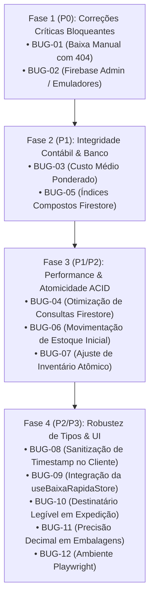

# 🛠 Plano de Implementação: Correção e Estabilização de Bugs e Falhas

> **Projeto:** Sistema de Almoxarifado Industrial  
> **Documento de Origem:** [Relatório de Varredura de Bugs e Falhas](file:///c:/Users/Eduardo/Desktop/exemplo/sistema_almoxarifado/docs/relatorio_varredura_bugs_e_falhas.md)  
> **Estratégia:** Execução incremental por fases de severidade com commits atômicos e testes automatizados a cada sub-etapa.  

---

## 📌 Visão Geral do Plano

Este plano organiza a correção dos 12 bugs e vulnerabilidades identificados na varredura técnica completa do sistema. As atividades foram divididas em **4 Fases Lógicas**, priorizando os bloqueios operacionais críticos que impedem movimentações reais, seguidos pelas regras de integridade contábil, performance de banco de dados e refinamento de interface.



---

## 🚀 FASE 1: Correções Críticas Bloqueantes de Operação (P0)

> **Objetivo:** Restaurar a capacidade operacional imediata do almoxarifado, permitindo que baixas manuais sejam gravadas com sucesso e que o backend Next.js responda localmente sem timeouts de credenciais.

### 🔹 Subtarefa 1.1: Componente de Seleção de Colaboradores e Autocomplete
- **Problema Abordado:** [BUG-01](file:///c:/Users/Eduardo/Desktop/exemplo/sistema_almoxarifado/docs/relatorio_varredura_bugs_e_falhas.md#bug-01-crítico--baixa-manual-de-material-falha-com-404-por-envio-de-texto-livre-como-colaboradorid)
- **Arquivos:**
  - `src/web/hooks/useColaboradores.ts` (ou ajustar hook existente)
  - `src/web/components/common/ColaboradorSelect.tsx` (novo componente de seleção acessível com busca por nome/matrícula)
- **Ações:**
  1. Criar componente reutilizável `ColaboradorSelect` que consome a lista de colaboradores ativos via API.
  2. Exibir nome, matrícula e setor do colaborador no dropdown.
  3. Emitir objeto `Colaborador` selecionado para os formulários pais.
- **Critério de Aceite:** O usuário pode pesquisar e selecionar um colaborador cadastrado com visualização do setor herdado.

### 🔹 Subtarefa 1.2: Integração do Colaborador no `MovementFormDrawer`
- **Problema Abordado:** [BUG-01](file:///c:/Users/Eduardo/Desktop/exemplo/sistema_almoxarifado/docs/relatorio_varredura_bugs_e_falhas.md#bug-01-crítico--baixa-manual-de-material-falha-com-404-por-envio-de-texto-livre-como-colaboradorid)
- **Arquivos:**
  - [`src/web/components/dashboard/drawers/MovementFormDrawer.tsx`](file:///c:/Users/Eduardo/Desktop/exemplo/sistema_almoxarifado/src/web/components/dashboard/drawers/MovementFormDrawer.tsx#L188-L195)
- **Ações:**
  1. Substituir o `<input type="text" value={quem} placeholder="Ex: Produção, Serralheria" />` pelo seletor de colaboradores quando `tipo === 'Saída'`.
  2. Enviar no payload de `POST /api/movimentacoes/baixa-interna`:
     ```typescript
     colaboradorId: colaboradorSelecionado.id,
     setor: colaboradorSelecionado.setor,
     ```
  3. Tratar erros amigáveis caso o operador tente submeter sem selecionar colaborador.
- **Critério de Aceite:** A baixa de material via Drawer lateral é gravada com status `201 Created` e associa a movimentação ao colaborador real.

### 🔹 Subtarefa 1.3: Integração do Colaborador na `SaidaManualView` e `useMovimentacoesPeriodo`
- **Problema Abordado:** [BUG-01](file:///c:/Users/Eduardo/Desktop/exemplo/sistema_almoxarifado/docs/relatorio_varredura_bugs_e_falhas.md#bug-01-crítico--baixa-manual-de-material-falha-com-404-por-envio-de-texto-livre-como-colaboradorid)
- **Arquivos:**
  - [`src/web/components/gestao/saida/SaidaManualView.tsx`](file:///c:/Users/Eduardo/Desktop/exemplo/sistema_almoxarifado/src/web/components/gestao/saida/SaidaManualView.tsx#L75)
  - [`src/web/hooks/useMovimentacoesPeriodo.ts`](file:///c:/Users/Eduardo/Desktop/exemplo/sistema_almoxarifado/src/web/hooks/useMovimentacoesPeriodo.ts#L281-L287)
- **Ações:**
  1. Atualizar a aba "Saída Manual" para incluir o seletor de colaborador com preenchimento automático do setor.
  2. Ajustar os parâmetros de `registrarMovimentacao` em `useMovimentacoesPeriodo.ts` para aceitar `colaboradorId` válido.
- **Critério de Aceite:** Saídas registradas na tela analítica são concluídas com sucesso e debitam o saldo físico do item.

### 🔹 Subtarefa 1.4: Suporte a Emuladores e Credenciais Resilientes no Firebase Admin
- **Problema Abordado:** [BUG-02](file:///c:/Users/Eduardo/Desktop/exemplo/sistema_almoxarifado/docs/relatorio_varredura_bugs_e_falhas.md#bug-02-crítico--backend-trava-em-timeout-de-adc-por-falta-de-credenciais-admin-ou-conexão-a-emuladores)
- **Arquivos:**
  - [`src/server/firebase-admin.ts`](file:///c:/Users/Eduardo/Desktop/exemplo/sistema_almoxarifado/src/server/firebase-admin.ts#L15-L39)
  - [`src/core/services/firebase.ts`](file:///c:/Users/Eduardo/Desktop/exemplo/sistema_almoxarifado/src/core/services/firebase.ts)
  - [`.env.example`](file:///c:/Users/Eduardo/Desktop/exemplo/sistema_almoxarifado/.env.example)
- **Ações:**
  1. Detectar no servidor `process.env.FIRESTORE_EMULATOR_HOST` e `process.env.FIREBASE_AUTH_EMULATOR_HOST`. Se definidos, inicializar sem travar na busca de ADC.
  2. No cliente `firebase.ts`, conectar `connectFirestoreEmulator` e `connectAuthEmulator` quando `process.env.NEXT_PUBLIC_USE_FIREBASE_EMULATOR === 'true'`.
  3. Atualizar `.env.example` fornecendo configurações documentadas para desenvolvimento com emulador e com service account.
- **Critério de Aceite:** O servidor Next.js responde às rotas de API sem latência ou timeout de lookup de credenciais do Google Cloud.

---

## 📈 FASE 2: Integridade Financeira, Contábil e Banco de Dados (P1)

> **Objetivo:** Assegurar que a valorização contábil do estoque reflita os custos reais das notas fiscais e que as consultas do Firestore não falhem por falta de índices.

### 🔹 Subtarefa 2.1: Repositório com Suporte a Atualização de Saldo e Custo Unitário
- **Problema Abordado:** [BUG-03](file:///c:/Users/Eduardo/Desktop/exemplo/sistema_almoxarifado/docs/relatorio_varredura_bugs_e_falhas.md#bug-03-alto--custo-médio-ponderado-não-é-recalculado-nem-atualizado-nas-entradas-de-estoque)
- **Arquivos:**
  - `src/core/storage/estoque.repository.interface.ts`
  - `src/server/storage/firestore-estoque.repository.ts`
  - `src/core/storage/memory-storage.adapter.ts`
- **Ações:**
  1. Adicionar o método `atualizarSaldoECustoItem(itemId: string, novoSaldo: number, novoCusto: number): Promise<void>` na interface `IEstoqueRepository`.
  2. Implementar a atualização simultânea de `estoqueAtual` e `custoUnitario` no Firestore dentro de transação atômica.
- **Critério de Aceite:** O repositório persiste de forma atômica o novo saldo e o novo custo médio ponderado do item.

### 🔹 Subtarefa 2.2: Integração do Custo Médio em `MovimentacaoService` e `NFeEntradaService`
- **Problema Abordado:** [BUG-03](file:///c:/Users/Eduardo/Desktop/exemplo/sistema_almoxarifado/docs/relatorio_varredura_bugs_e_falhas.md#bug-03-alto--custo-médio-ponderado-não-é-recalculado-nem-atualizado-nas-entradas-de-estoque)
- **Arquivos:**
  - [`src/core/services/movimentacao.service.ts`](file:///c:/Users/Eduardo/Desktop/exemplo/sistema_almoxarifado/src/core/services/movimentacao.service.ts#L182-L213)
  - [`src/core/services/nfe-entrada.service.ts`](file:///c:/Users/Eduardo/Desktop/exemplo/sistema_almoxarifado/src/core/services/nfe-entrada.service.ts#L193-L222)
- **Ações:**
  1. Em `executarEntrada`: se `valorUnitario > 0`, invocar `calcularCustoMedioPonderado(saldoAnterior, item.custoUnitario || 0, quantidade, valorUnitario)` e persistir o novo custo médio.
  2. Em `efetivarEntradaNFe`: utilizar o valor unitário faturado do item da NF-e para atualizar o custo unitário médio do produto no almoxarifado.
  3. Adicionar testes unitários garantindo que entradas recalculam o custo médio ponderado conforme fórmula contábil.
- **Critério de Aceite:** Ao dar entrada em 10 itens com custo R$ 100 em estoque existente de 10 itens a R$ 50, o custo unitário do item no catálogo é atualizado para R$ 75,00.

### 🔹 Subtarefa 2.3: Declaração dos Índices Compostos no `firestore.indexes.json`
- **Problema Abordado:** [BUG-05](file:///c:/Users/Eduardo/Desktop/exemplo/sistema_almoxarifado/docs/relatorio_varredura_bugs_e_falhas.md#bug-05-alto--falta-de-índices-compostos-em-firestoreindexesjson-para-consultas-de-auditoria)
- **Arquivos:**
  - [`firestore.indexes.json`](file:///c:/Users/Eduardo/Desktop/exemplo/sistema_almoxarifado/firestore.indexes.json)
- **Ações:**
  1. Configurar índices para `auditoria_operacional`:
     - `acao` (ASC) + `createdAt` (DESC)
     - `usuarioId` (ASC) + `createdAt` (DESC)
  2. Configurar índices para `movements`:
     - `itemId` (ASC) + `dataMovimentacao` (DESC)
     - `tipo` (ASC) + `dataMovimentacao` (DESC)
- **Critério de Aceite:** A tela de auditoria e o extrato de itens filtram registros sem estourar `FAILED_PRECONDITION`.

---

## ⚡ FASE 3: Otimização de Performance e Transacionalidade ACID (P1/P2)

> **Objetivo:** Eliminar leituras completas de banco desnecessárias e garantir que o inventário e abertura de cadastro tenham rastreabilidade estrita.

### 🔹 Subtarefa 3.1: Otimização de Consultas em `useDashboardResumo` e Rotas de API
- **Problema Abordado:** [BUG-04](file:///c:/Users/Eduardo/Desktop/exemplo/sistema_almoxarifado/docs/relatorio_varredura_bugs_e_falhas.md#bug-04-alto--varredura-de-coleções-inteiras-sem-paginação-ou-limite-temporal-no-firestore)
- **Arquivos:**
  - [`src/web/hooks/useDashboardResumo.ts`](file:///c:/Users/Eduardo/Desktop/exemplo/sistema_almoxarifado/src/web/hooks/useDashboardResumo.ts#L131-L148)
  - [`src/server/storage/firestore-estoque.repository.ts`](file:///c:/Users/Eduardo/Desktop/exemplo/sistema_almoxarifado/src/server/storage/firestore-estoque.repository.ts#L324-L365)
- **Ações:**
  1. Em `useDashboardResumo.ts`, aplicar filtro de data na consulta de movimentações: `query(collection(db, 'movements'), where('dataMovimentacao', '>=', hojeISO))`.
  2. Em `firestore-estoque.repository.ts` (`listarMovimentacoes`), aplicar `.orderBy('dataMovimentacao', 'desc').limit(limite)` diretamente na query do Firestore em vez de baixar a coleção completa.
- **Critério de Aceite:** A carga do Dashboard executa leituras proporcionais ao dia e não baixa o histórico acumulado de anos anteriores.

### 🔹 Subtarefa 3.2: Registro de Movimentação de Abertura para `estoqueInicial > 0`
- **Problema Abordado:** [BUG-06](file:///c:/Users/Eduardo/Desktop/exemplo/sistema_almoxarifado/docs/relatorio_varredura_bugs_e_falhas.md#bug-06-médio--cadastro-de-item-com-estoqueinicial--0-não-registra-movimentação-no-extrato)
- **Arquivos:**
  - [`src/web/app/api/itens/route.ts`](file:///c:/Users/Eduardo/Desktop/exemplo/sistema_almoxarifado/src/web/app/api/itens/route.ts#L104-L113)
- **Ações:**
  1. Se `input.estoqueInicial > 0`, registrar movimentação do tipo `AJUSTE_INVENTARIO_POSITIVO` com observação `'Saldo de implantação/abertura de cadastro'`.
  2. Vincular a movimentação ao usuário autenticado criador do item.
- **Critério de Aceite:** Ao cadastrar item com 50 unidades, o extrato exibe imediatamente o lançamento de abertura de saldo.

### 🔹 Subtarefa 3.3: Ajuste de Inventário em Lote com Transação Única
- **Problema Abordado:** [BUG-07](file:///c:/Users/Eduardo/Desktop/exemplo/sistema_almoxarifado/docs/relatorio_varredura_bugs_e_falhas.md#bug-07-médio--ajuste-de-inventário-em-lote-não-é-transacional-falta-de-atomicidade-acid)
- **Arquivos:**
  - `src/server/storage/firestore-estoque.repository.ts`
  - [`src/web/app/api/inventario/ajuste-direto/route.ts`](file:///c:/Users/Eduardo/Desktop/exemplo/sistema_almoxarifado/src/web/app/api/inventario/ajuste-direto/route.ts#L58-L90)
- **Ações:**
  1. Criar método transacional no repositório que agrupe leituras de saldo e gravações de ajuste dentro de um `runTransaction`.
  2. Atualizar a rota `/api/inventario/ajuste-direto` para utilizar a transação atômica.
- **Critério de Aceite:** Caso ocorra erro em qualquer item do lote de contagem física, toda a operação sofre rollback atômico.

---

## 🎨 FASE 4: Robustez de Tipos, Usabilidade e Integração de UI (P2/P3)

> **Objetivo:** Eliminar riscos de quebra de runtime no cliente, aproximar a experiência do chão de fábrica e ajustar pequenas inconsistências visuais.

### 🔹 Subtarefa 4.1: Sanitização de `Timestamp` no Fallback de `useItensEstoque`
- **Problema Abordado:** [BUG-08](file:///c:/Users/Eduardo/Desktop/exemplo/sistema_almoxarifado/docs/relatorio_varredura_bugs_e_falhas.md#bug-08-médio--fallback-do-firestore-em-useitensestoque-expõe-instâncias-de-timestamp-não-tratadas)
- **Arquivos:**
  - [`src/web/hooks/useItensEstoque.ts`](file:///c:/Users/Eduardo/Desktop/exemplo/sistema_almoxarifado/src/web/hooks/useItensEstoque.ts#L106-L115)
- **Ações:**
  1. Criar helper leve de cliente que verifica se `createdAt` ou `updatedAt` possuem método `.toDate()` ou propriedades `{ seconds, nanoseconds }` e converte para string ISO `toISOString()`.
- **Critério de Aceite:** O fallback do cliente não injeta instâncias de `Timestamp` no estado do React.

### 🔹 Subtarefa 4.2: Integração Visual do Carrinho de Retirada (`useBaixaRapidaStore`)
- **Problema Abordado:** [BUG-09](file:///c:/Users/Eduardo/Desktop/exemplo/sistema_almoxarifado/docs/relatorio_varredura_bugs_e_falhas.md#bug-09-médio--desconexão-da-store-usebaixarapidastore-no-frontend)
- **Arquivos:**
  - `src/web/components/gestao/saida/BaixaRapidaDrawer.tsx` (nova gaveta operacional de carrinho)
  - [`src/web/components/layout/AppRibbonHeader.tsx`](file:///c:/Users/Eduardo/Desktop/exemplo/sistema_almoxarifado/src/web/components/layout/AppRibbonHeader.tsx)
  - [`src/web/app/page.tsx`](file:///c:/Users/Eduardo/Desktop/exemplo/sistema_almoxarifado/src/web/app/page.tsx)
- **Ações:**
  1. Desenvolver `BaixaRapidaDrawer` conectada à store `useBaixaRapidaStore`.
  2. Permitir que o almoxarife selecione o colaborador uma única vez e adicione múltiplos itens por leitor de código de barras ou busca rápida.
  3. Vincular botão da Ribbon Bar para acionar este carrinho ágil.
- **Critério de Aceite:** O operador pode registrar a saída de múltiplos itens simultaneamente para o mesmo colaborador através de um único clique atômico.

### 🔹 Subtarefa 4.3: Nome Legível de Cliente no Histórico de Expedição de Pedidos
- **Problema Abordado:** [BUG-10](file:///c:/Users/Eduardo/Desktop/exemplo/sistema_almoxarifado/docs/relatorio_varredura_bugs_e_falhas.md#bug-10-baixo--id-oculto-do-cliente-gravado-no-lugar-do-nome-no-histórico-de-expedição-de-pedidos)
- **Arquivos:**
  - [`src/web/app/api/pedidos/[id]/route.ts`](file:///c:/Users/Eduardo/Desktop/exemplo/sistema_almoxarifado/src/web/app/api/pedidos/%5Bid%5D/route.ts#L119)
- **Ações:**
  1. Na transação de entrega do pedido, recuperar o nome do cliente através do documento em `clients` ou metadados do pedido.
  2. Gravar no campo `destinatario`: `clienteNome || pedido.clienteId`.
- **Critério de Aceite:** O extrato de movimentações exibe a razão social ou nome da empresa compradora no despacho de pedidos.

### 🔹 Subtarefa 4.4: Proteção Contra Resíduos Decimais em Embalagens
- **Problema Abordado:** [BUG-11](file:///c:/Users/Eduardo/Desktop/exemplo/sistema_almoxarifado/docs/relatorio_varredura_bugs_e_falhas.md#bug-11-baixo--imprecisão-decimal-por-ponto-flutuante-em-conversão-de-unidades-e-embalagens)
- **Arquivos:**
  - [`src/core/domain/item.schema.ts`](file:///c:/Users/Eduardo/Desktop/exemplo/sistema_almoxarifado/src/core/domain/item.schema.ts#L173-L175)
- **Ações:**
  1. Aplicar `arredondar3(quantidadeUnidades % fatorConversao)` no cálculo de sobra fracionada.
- **Critério de Aceite:** O cálculo de sobra avulsa não produz resíduos como `.0000000000000004`.

### 🔹 Subtarefa 4.5: Documentação e Script de Configuração do Playwright
- **Problema Abordado:** [BUG-12](file:///c:/Users/Eduardo/Desktop/exemplo/sistema_almoxarifado/docs/relatorio_varredura_bugs_e_falhas.md#bug-12-infra--falha-no-download-do-driver-do-playwright-no-ambiente-windows)
- **Arquivos:**
  - `package.json`
  - `docs/guia_execucao_testes_e2e.md`
- **Ações:**
  1. Incluir script `test:e2e:install` executando `npx playwright install chromium --with-deps`.
  2. Documentar configuração recomendada para ambientes Windows corporativos.
- **Critério de Aceite:** O ambiente dispõe de documentação e atalho para inicialização do driver gráfico sem erro 404 de CDN.

---

## 📊 Matriz de Rastreabilidade e Estimativa de Impacto

| Fase | Subtarefas | Esforço Estimado | Risco de Regressão | Impacto Operacional |
| :--- | :--- | :--- | :--- | :--- |
| **Fase 1** | 1.1, 1.2, 1.3, 1.4 | 🟡 Médio | 🟢 Baixo (aditivo/correção) | 🟢 **Desbloqueia saídas manuais e dev local** |
| **Fase 2** | 2.1, 2.2, 2.3 | 🟡 Médio | 🟡 Médio (cálculo de custos) | 🟢 **Garante acurácia contábil e auditoria** |
| **Fase 3** | 3.1, 3.2, 3.3 | 🟠 Alto | 🟡 Médio (queries e transações) | 🟢 **Evita estouro de custos e garante ACID** |
| **Fase 4** | 4.1, 4.2, 4.3, 4.4, 4.5 | 🟡 Médio | 🟢 Baixo | 🟢 **Eleva UX e usabilidade do chão de fábrica** |
