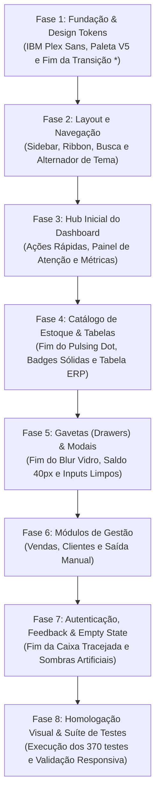

# Plano de Implementação: Eliminação de AI Slop UI e Transição para Design Humano Industrial

> **Base Técnica:** Auditoria [docs/relatorio_auditoria_design_taste_frontend.md](file:///c:/Users/Eduardo/Desktop/exemplo/sistema_almoxarifado/docs/relatorio_auditoria_design_taste_frontend.md)  
> **Referência de Design Humano:** Protótipo Operacional [Front end Almoxarifado/almoxarifado5.html](file:///c:/Users/Eduardo/Desktop/exemplo/sistema_almoxarifado/Front%20end%20Almoxarifado/almoxarifado5.html)  
> **Premissa Inegociável:** Preservar rigorosamente a integridade funcional e a aprovação de 100% dos 370 testes existentes do sistema.

---

## Visão Geral das Fases



---

## Detalhamento das Fases de Execução

### Fase 1: Fundação, Tipografia & Design Tokens Globais
**Objetivo:** Substituir a estética de "IA padrão" nos alicerces visuais da aplicação.

1. **Migração Tipográfica**:
   - Arquivo: [src/web/app/layout.tsx](file:///c:/Users/Eduardo/Desktop/exemplo/sistema_almoxarifado/src/web/app/layout.tsx)
   - Substituir `Inter` por **`IBM Plex Sans`** (pesos 400, 500, 600, 700), mantendo a variável CSS `--font-sans`.
   - Manter `JetBrains Mono` estrita para códigos técnicos (SKU, lote, NF-e, endereços de prateleira).
2. **Tokens de Cores e Degraus de Superfície**:
   - Arquivo: [src/web/app/globals.css](file:///c:/Users/Eduardo/Desktop/exemplo/sistema_almoxarifado/src/web/app/globals.css)
   - Adotar a paleta testada e aprovada de [almoxarifado5.html](file:///c:/Users/Eduardo/Desktop/exemplo/sistema_almoxarifado/Front%20end%20Almoxarifado/almoxarifado5.html):
     - **Modo Claro:** `--bg: #e9eff7`, `--surface: #ffffff`, `--line: #d9dfe5`, `--ink: #17212b`, `--muted: #5b6876`, `--brand: #1d4ea3`, `--brand-ink: #ffffff`, `--ok: #2e7d4f`, `--low: #a85f00`, `--crit: #c8322b`, `--sky: #4fa8e0`, `--yellow: #f2b705`, `--rib: #e8edf4`.
     - **Modo Escuro:** `--bg: #232325`, `--surface: #2b2b2e`, `--side: #1a1a1c`, `--line: #3e3e42`, `--ink: #ececee`, `--muted: #a3a3a9`, `--brand: #5aa9ea`, `--brand-ink: #06182e`, `--ok: #5ec58a`, `--low: #e9a23b`, `--crit: #f0796b`, `--sky: #7cc3f2`, `--yellow: #f5c431`, `--rib: #2f2f32`.
   - **Remover a regra de desempenho negativo:** Deletar `* { transition-property: background-color, border-color, ...; transition-duration: 150ms; }` para eliminar repinturas globais desnecessárias em tabelas densas.
   - Definir classes de raios padronizados: `rounded-md` (6px a 8px) para botões/inputs; `rounded-lg` (10px) para painéis/tabelas.

---

### Fase 2: Layout Corporativo, Navegação e Topo
**Objetivo:** Transformar a moldura da aplicação em uma estação de trabalho industrial.

1. **[AppSidebar.tsx](file:///c:/Users/Eduardo/Desktop/exemplo/sistema_almoxarifado/src/web/components/layout/AppSidebar.tsx)**:
   - Alinhar background do dark mode para `--side` (`#1a1a1c`), eliminando o azul petróleo saturado.
   - Substituir a badge circular flutuante `rounded-full` por uma tag nítida com cantos de 4px (`rounded-sm`).
   - Remover o container quadrado azul decorativo do avatar; usar tipografia compacta e direta.
2. **[AppRibbonHeader.tsx](file:///c:/Users/Eduardo/Desktop/exemplo/sistema_almoxarifado/src/web/components/layout/AppRibbonHeader.tsx)**:
   - Eliminar sombras difusas nos botões verticais da Ribbon (`.rb`).
   - Manter a faixa de 88px com hover suave em tom sky (`color-mix(in srgb, var(--sky) 18%, transparent)`) e borda divisória sutil entre grupos funcionais (`.grp2`).
3. **[GlobalSearchInput.tsx](file:///c:/Users/Eduardo/Desktop/exemplo/sistema_almoxarifado/src/web/components/layout/GlobalSearchInput.tsx)**:
   - Trocar `rounded-xl` e `shadow-2xs` por `rounded-md` (8px), com borda de 1px e anel de foco limpo sem borrões.
4. **[ThemeToggle.tsx](file:///c:/Users/Eduardo/Desktop/exemplo/sistema_almoxarifado/src/web/components/layout/ThemeToggle.tsx)**:
   - Manter botão minimalista de 32x32px (`rounded-md`), com borda de 1px integrada ao grid do topo.

---

### Fase 3: Hub Executivo & Ações Rápidas (Início)
**Objetivo:** Eliminar o "efeito brinquedo" do dashboard inicial.

1. **[QuickActionsBar.tsx](file:///c:/Users/Eduardo/Desktop/exemplo/sistema_almoxarifado/src/web/components/dashboard/inicio/QuickActionsBar.tsx)**:
   - **Fim da disparidade de raios:** Substituir o botão `rounded-xl` e os 3 botões em formato pílula `rounded-full` por botões de raio único (`rounded-md`, 6px) e altura idêntica (36px).
   - **Fim dos Rainbow Icons:** Remover cores arbitrárias de ícones (`text-rose-500`, `text-blue-500`, `text-emerald-500`); ícones herdam a cor funcional do texto do botão.
   - **Remover sombras flutuantes:** Eliminar `hover:shadow-md`.
2. **[AttentionPanel.tsx](file:///c:/Users/Eduardo/Desktop/exemplo/sistema_almoxarifado/src/web/components/dashboard/inicio/AttentionPanel.tsx)**:
   - Substituir as badges em pílula `rounded-full` por etiquetas retangulares elegantes (`rounded-md`, 6px, classes `.tag.crit` e `.tag.low`).
   - Alinhar a lista como um painel operacional sóbrio com bordas de 1px.
3. **[SummaryNavCard.tsx](file:///c:/Users/Eduardo/Desktop/exemplo/sistema_almoxarifado/src/web/components/dashboard/inicio/SummaryNavCard.tsx)**:
   - Remover os ícones decorativos isolados no topo do card (`UserIcon`, `Layers`, `Wrench`). O destaque do card é o valor numérico em 34px tabular e o título em 17px semi-bold.
   - Trocar cantos `rounded-xl` por `rounded-lg` (10px). Remover `hover:shadow-md`.
   - Manter a borda superior característica de 3px (`sky` ou `brand`).
4. **[InicioDashboardView.tsx](file:///c:/Users/Eduardo/Desktop/exemplo/sistema_almoxarifado/src/web/components/dashboard/inicio/InicioDashboardView.tsx)**:
   - Ajustar tipografia dos títulos e espaçamento entre seções com ritmo consistente (gap 16px).

---

### Fase 4: Catálogo de Estoque & Tabelas de Alta Densidade
**Objetivo:** Transformar a visualização de inventário em uma tabela ERP profissional.

1. **[StockStatusBadge.tsx](file:///c:/Users/Eduardo/Desktop/exemplo/sistema_almoxarifado/src/web/components/dashboard/StockStatusBadge.tsx)**:
   - **Remover terminantemente `animate-pulse`** no indicador crítico.
   - Eliminar a redundância de dot decorativo + badge + texto: estruturar como tag sólida de 6px (`rounded-md`) com fundo pastel de alto contraste (`.tag.ok`, `.tag.low`, `.tag.crit`).
2. **[StockGauge.tsx](file:///c:/Users/Eduardo/Desktop/exemplo/sistema_almoxarifado/src/web/components/dashboard/StockGauge.tsx)**:
   - Adotar a estrutura clássica de 8px de altura com trilha neutra e marcador de corte nítido (`almoxarifado5.html .gauge`).
3. **[StockTable.tsx](file:///c:/Users/Eduardo/Desktop/exemplo/sistema_almoxarifado/src/web/components/dashboard/StockTable.tsx)**:
   - Remover `shadow-2xs` do contêiner da tabela.
   - Padronizar padding das linhas entre 9px e 11px verticais.
   - Refatorar os botões de ação na linha (+ Entrada / Retirar) para o estilo minimalista `.mini` (sem bordas coloridas estridentes competindo com a leitura do saldo).
4. **[StockMetricsCards.tsx](file:///c:/Users/Eduardo/Desktop/exemplo/sistema_almoxarifado/src/web/components/dashboard/StockMetricsCards.tsx)**:
   - Alinhar com a classe `.stat` (borda superior de 3px sky/yellow/red, sem sombras em repouso e sem mono desnecessária em "100% catálogo").
5. **[StockFilterToolbar.tsx](file:///c:/Users/Eduardo/Desktop/exemplo/sistema_almoxarifado/src/web/components/dashboard/StockFilterToolbar.tsx)**:
   - Substituir chips de pílula por chips de borda limpa com estado ativo preenchido de forma sólida.

---

### Fase 5: Gavetas Operacionais (Drawers) e Modais
**Objetivo:** Tornar os fluxos de entrada, retirada e cadastro sóbrios, diretos e livres de efeitos de vidro.

1. **Eliminação de Vidro / Blur em Todos os Drawers**:
   - [ItemDetailsDrawer.tsx](file:///c:/Users/Eduardo/Desktop/exemplo/sistema_almoxarifado/src/web/components/dashboard/ItemDetailsDrawer.tsx)
   - [ItemCreateDrawer.tsx](file:///c:/Users/Eduardo/Desktop/exemplo/sistema_almoxarifado/src/web/components/dashboard/drawers/ItemCreateDrawer.tsx)
   - [MovementFormDrawer.tsx](file:///c:/Users/Eduardo/Desktop/exemplo/sistema_almoxarifado/src/web/components/dashboard/drawers/MovementFormDrawer.tsx)
   - [QuickItemPickerDrawer.tsx](file:///c:/Users/Eduardo/Desktop/exemplo/sistema_almoxarifado/src/web/components/dashboard/drawers/QuickItemPickerDrawer.tsx)
   - [OrderCreateDrawer.tsx](file:///c:/Users/Eduardo/Desktop/exemplo/sistema_almoxarifado/src/web/components/gestao/vendas/OrderCreateDrawer.tsx)
   - [ClientCreateDrawer.tsx](file:///c:/Users/Eduardo/Desktop/exemplo/sistema_almoxarifado/src/web/components/gestao/clientes/ClientCreateDrawer.tsx)
   - Remover `backdrop-blur-xs`, `backdrop-blur-sm`, `backdrop-blur-md` e sombras `shadow-2xl`. Fundo 100% opaco na cor da superfície (`--surface`) com borda lateral nítida de 1px.
2. **Refatoração do `ItemDetailsDrawer`**:
   - Substituir o box de saldo `rounded-2xl` por uma visualização sóbria com o valor em 40px bold (`.big`).
   - Apresentar especificações e parâmetros técnicos em lista limpa de duas colunas (`dl`/`dt`/`dd`), removendo ícones supérfluos (`Cpu`, `MapPin`, `ShieldAlert`).

---

### Fase 6: Telas de Gestão (Vendas, Clientes, Saída Manual)
**Objetivo:** Consolidar consistência visual nas visões operacionais de negócio.

1. **[VendasView.tsx](file:///c:/Users/Eduardo/Desktop/exemplo/sistema_almoxarifado/src/web/components/gestao/vendas/VendasView.tsx)** & **[OrderStatusBadge.tsx](file:///c:/Users/Eduardo/Desktop/exemplo/sistema_almoxarifado/src/web/components/gestao/vendas/OrderStatusBadge.tsx)**:
   - Substituir os 3 cards de KPI com borda esquerda grossa e `shadow-2xs` pela grade `.stat` padronizada.
   - Consolidar status do pedido em etiqueta única legível, evitando acúmulo de múltiplos micro-badges coloridos.
2. **[ClientesView.tsx](file:///c:/Users/Eduardo/Desktop/exemplo/sistema_almoxarifado/src/web/components/gestao/clientes/ClientesView.tsx)**:
   - Substituir chips de tipo com contadores em pílula microscópica por chips planos onde a contagem fica naturalmente entre parênteses.
   - Remover ícones coloridos por tipo de parceiro.
3. **[SaidaManualView.tsx](file:///c:/Users/Eduardo/Desktop/exemplo/sistema_almoxarifado/src/web/components/gestao/saida/SaidaManualView.tsx)**:
   - Alinhar o painel de lançamento com bordas nítidas de 1px (`border-line`) sem sombra difusa.
   - Tabela sintética consolidada com números alinhados rigorosamente à direita e com `tabular-nums`.

---

### Fase 7: Autenticação, Feedback & Empty States
**Objetivo:** Remover os últimos clichês evidentes de IA.

1. **[EmptyState.tsx](file:///c:/Users/Eduardo/Desktop/exemplo/sistema_almoxarifado/src/web/components/feedback/EmptyState.tsx)**:
   - **Remover a caixa tracejada cinza (`border-dashed`) e o círculo cinza `rounded-full` com ícone no centro**.
   - Adotar um bloco simples, limpo e direto (`.empty` do protótipo), com mensagem clara e botão de ação funcional.
2. **[login/page.tsx](file:///c:/Users/Eduardo/Desktop/exemplo/sistema_almoxarifado/src/web/app/login/page.tsx)** & **[LoginForm.tsx](file:///c:/Users/Eduardo/Desktop/exemplo/sistema_almoxarifado/src/web/components/auth/LoginForm.tsx)**:
   - Remover caixa azul arredondada do ícone `Boxes`.
   - Adotar rótulos em Sentence case nos campos (removendo `uppercase tracking-wide`).
   - Botão principal com preenchimento sólido sem sombra difusa.
3. **[UserProfileCard.tsx](file:///c:/Users/Eduardo/Desktop/exemplo/sistema_almoxarifado/src/web/components/UserProfileCard.tsx)**:
   - Refatorar removendo o clássico clichê do ícone flutuante em caixa azul arredondada e a sombra `shadow-md`.
4. **[ToastContainer.tsx](file:///c:/Users/Eduardo/Desktop/exemplo/sistema_almoxarifado/src/web/components/feedback/ToastContainer.tsx)**:
   - Cantos elegantes de 8px a 10px (`rounded-md`), fundo sólido escuro com alto contraste e borda de 1px.

---

### Fase 8: Validação Contínua, Testes de Regressão e Homologação
**Objetivo:** Garantir zero quebra de funcionalidade e excelência de acabamento.

1. Executar a suíte de testes completa:
   ```powershell
   npm test
   ```
   - **Meta:** Manter 100% de aprovação (370/370 testes passando).
2. Validação visual e de responsividade em viewports móvel (375px), tablet (768px) e desktop (1280px / 1920px).
3. Verificação de temas: alternância perfeita entre tema Claro (`#e9eff7`) e Escuro (`#232325` grafite), garantindo contraste WCAG AA em todos os textos.

---

## Cronograma de Entregas Sugerido

| Sprint / Passo | Fases Contempladas | Entregáveis Principais |
| :--- | :--- | :--- |
| **Passo 1** | Fase 1 & Fase 2 | Tokens globais, tipografia `IBM Plex Sans`, paleta industrial V5, sidebar e cabeçalhos. |
| **Passo 2** | Fase 3 & Fase 4 | Fim do `animate-pulse` e pílulas em ações rápidas, tabela de estoque com estilo ERP e badges sólidas. |
| **Passo 3** | Fase 5 & Fase 6 | Eliminação de blur de vidro em todos os Drawers, alinhamento das views de Vendas, Clientes e Saída. |
| **Passo 4** | Fase 7 & Fase 8 | Refatoração de Empty States, Login e validação final da suíte com 370 testes. |
