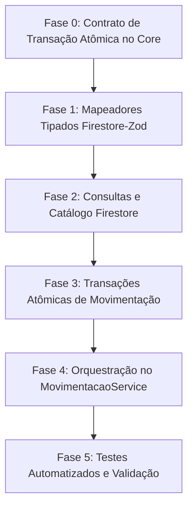

# Plano de Implementação: Persistência Real no Firestore com Transações Atômicas

## 1. Objetivo e Contexto

Este plano estabelece a implementação da persistência real de dados de estoque no **Google Cloud Firestore**, substituindo a dependência exclusiva do `MemoryEstoqueRepository` por um adaptador de produção resiliente: o **`FirestoreEstoqueRepository`**.

O objetivo central é garantir **integridade estrita e ACID** em todas as operações de movimentação física (entradas por compra/NFe, baixas rápidas por colaborador e expedições), impedindo condições de corrida (*race conditions*), saldos negativos e divergências entre o saldo consolidado do item e seu histórico de auditoria.

### Relação com as Regras de Segurança
Conforme definido em `firestore.rules`:
- A alteração direta do campo `estoqueAtual` na coleção `items` é **bloqueada para clientes web/mobile**.
- Todas as mutações físicas de estoque devem ser executadas em **ambiente backend confiável** através do **Firebase Admin SDK** (`adminDb`), assegurando que nenhuma regra de negócio seja burlada no cliente.

---

## 2. Princípios de Engenharia e Arquitetura

1. **Agnosticismo do Core Preservado:**
   - O Core (`src/core`) continua dependendo apenas do contrato `IEstoqueRepository`.
   - A implementação concreta com Firebase Admin residirá em `src/server/storage/firestore-estoque.repository.ts`, com injeção de dependência via portas e adaptadores (Arquitetura Hexagonal).
2. **Atomicidade Estrita (ACID via `runTransaction`):**
   - Nenhuma movimentação poderá existir sem que o saldo do item seja atualizado no mesmo instante.
   - Nenhuma atualização de saldo poderá ocorrer sem o registro imutável correspondente na coleção `movements`.
   - Se qualquer item de uma baixa em lote apresentar saldo insuficiente no momento da transação, o lote inteiro será cancelado automaticamente pelo Firestore.
3. **Idempotência e Trilha de Auditoria:**
   - Cada movimentação física conterá `saldoAnterior`, `saldoResultante`, `createdAt` e referência ao operador ou nota fiscal.
4. **Retrocompatibilidade com Testes Existentes:**
   - Os 118 testes unitários de `src/core` continuarão executando em memória com 100% de sucesso.
   - O `MemoryEstoqueRepository` implementará os mesmos métodos atômicos para simulação determinística em testes.

---

## 3. Modelo de Coleções no Firestore

| Coleção | Document ID | Campos Principais | Finalidade |
| :--- | :--- | :--- | :--- |
| `items` | ID do Item (`uuid` ou chave) | `codigo`, `descricao`, `tipo`, `unidade`, `estoqueAtual`, `estoqueSeguranca`, `ativo`, etc. | Catálogo mestre de materiais e saldo físico consolidado. |
| `collaborators` | ID / Matrícula | `matricula`, `nome`, `setor`, `funcao`, `ativo`, etc. | Registro de colaboradores autorizados para retirada. |
| `movements` | ID da Movimentação | `itemId`, `tipo`, `quantidade`, `saldoAnterior`, `saldoResultante`, `dataMovimentacao`, `colaboradorId`, `numeroNF`, etc. | Trilha imutável de auditoria de movimentações. |
| `inventorySessions` | ID da Sessão | `codigo`, `tipo`, `status`, `dataAbertura`, `itens`, `divergencias` | Sessões de inventário e contagem física periódica. |

---

## 4. Fases Sequenciais de Implementação

A execução está dividida em **5 Fases Atômicas**, permitindo revisões e commits pequenos:

---

### Fase 0: Extensão do Contrato de Persistência no Core
> **Objetivo:** Adicionar assinaturas atômicas no contrato `IEstoqueRepository` e atualizar o `MemoryEstoqueRepository` sem quebrar nenhum teste existente.

- **Micro-tarefas:**
  - [x] **0.1** Adicionar métodos atômicos na interface `IEstoqueRepository` (`src/core/storage/estoque.repository.interface.ts`):
    - `registrarMovimentacaoComSaldo(itemId: string, novoSaldo: number, movimentacao: Movimentacao): Promise<Movimentacao>`
    - `registrarBaixaLoteAtomica(operacoes: Array<{ itemId: string; novoSaldo: number; movimentacao: Movimentacao }>): Promise<Movimentacao[]>`
  - [x] **0.2** Implementar os métodos em `MemoryEstoqueRepository` (`src/core/storage/memory-estoque.adapter.ts`), mantendo comportamento atômico em memória.
  - [x] **0.3** Executar a suíte de testes unitários para validar que os 120 testes existentes permanecem 100% íntegros.

---

### Fase 1: Mapeadores Tipados e Conversores de Dados
> **Objetivo:** Garantir a conversão segura e bidirecional entre documentos do Firestore (com `Timestamps` ou campos raw) e os Schemas Zod de domínio.

- **Micro-tarefas:**
  - [x] **1.1** Criar `src/server/storage/firestore-estoque.mapper.ts`:
    - Conversão de documento Firestore para entidade `Item` (com validação via `ItemSchema`).
    - Conversão de documento Firestore para entidade `Colaborador` (com validação via `ColaboradorSchema`).
    - Conversão de documento Firestore para entidade `Movimentacao` (com validação via `MovimentacaoSchema`).
  - [x] **1.2** Criar sanitizadores para garantir que campos `undefined` sejam omitidos antes de enviar ao Firestore.

---

### Fase 2: Consultas, Catálogo e CRUD Base no Firestore
> **Objetivo:** Implementar métodos de leitura indexada e operações não transacionais no repositório.

- **Micro-tarefas:**
  - [ ] **2.1** Criar classe `FirestoreEstoqueRepository` em `src/server/storage/firestore-estoque.repository.ts`.
  - [ ] **2.2** Implementar `buscarItemPorId(id)` e `buscarPorCodigo(codigo)` utilizando queries indexadas por código padronizado.
  - [ ] **2.3** Implementar `listarComFiltros(filtros)` com suporte a paginação por limite/offset ou cursor, filtros de tipo e status de estoque.
  - [ ] **2.4** Implementar `buscarColaboradorPorId(idOrMatricula)` e `listarColaboradores(filtros)`.
  - [ ] **2.5** Implementar `consultarExtratoItem(itemId, filtros)` e `listarMovimentacoes(filtros)` com ordenação cronológica decrescente.

---

### Fase 3: Transações Atômicas de Movimentação no Firestore
> **Objetivo:** Implementar o núcleo ACID com `adminDb.runTransaction()`, assegurando consistência estrita contra concorrência.

- **Micro-tarefas:**
  - [ ] **3.1** Implementar `registrarMovimentacaoComSaldo`:
    - Dentro de `runTransaction`:
      1. Ler `itemRef`.
      2. Validar existência e integridade do saldo atual do item.
      3. Atualizar atomicamente `estoqueAtual` e `updatedAt` no documento do item.
      4. Inserir documento imutável na coleção `movements/{movimentacaoId}`.
  - [ ] **3.2** Implementar `registrarBaixaLoteAtomica`:
    - Dentro de uma única `runTransaction`:
      1. Executar leituras de todos os itens envolvidos no lote.
      2. Validar que nenhum item teve seu saldo violado por concorrência entre a montagem do carrinho e a confirmação.
      3. Executar escritas em lote: débito nos documentos de cada item e criação de todos os registros de movimentação em `movements`.
      4. Abortar a transação integralmente caso ocorra qualquer erro ou divergência de saldo.

---

### Fase 4: Orquestração no MovimentacaoService
> **Objetivo:** Fazer o `MovimentacaoService` delegar as operações para os métodos atômicos do repositório, mantendo compatibilidade de fallback.

- **Micro-tarefas:**
  - [ ] **4.1** Atualizar `MovimentacaoService.executarEntrada`, `executarBaixaInterna` e `executarSaidaExpedicao` para utilizar `registrarMovimentacaoComSaldo` se suportado pelo repositório.
  - [ ] **4.2** Atualizar `MovimentacaoService.executarBaixaLote` para utilizar `registrarBaixaLoteAtomica`, garantindo que o lote seja processado em uma única operação atômica de banco de dados.

---

### Fase 5: Testes Automatizados e Validação
> **Objetivo:** Cobrir a camada Firestore com testes unitários e de integração, garantindo que cenários de concorrência e abortos de transação se comportem como esperado.

- **Micro-tarefas:**
  - [ ] **5.1** Criar testes para o `firestore-estoque.mapper.ts`.
  - [ ] **5.2** Criar suite de testes para `FirestoreEstoqueRepository` cobrindo sucesso e reversão (*rollback*) em caso de saldo insuficiente.
  - [ ] **5.3** Validar execução global dos testes (`npm test`).

---

## 5. Próximo Passo Imediato

Iniciar pela **Fase 0**: estender o contrato `IEstoqueRepository` e atualizar o `MemoryEstoqueRepository` com métodos de transação atômica, garantindo que todos os testes existentes continuem verdes.
