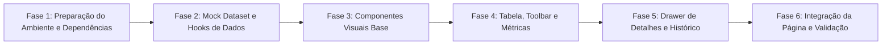

# Plano de Implementação: Frontend React do Almoxarifado

## 1. Visão Geral e Objetivo

Este documento estabelece o plano técnico e executivo para a migração e modernização da interface de monitoração de estoque do Almoxarifado, transformando o protótipo estático entregue pela equipe externa ([`Front end Almoxarifado/almoxarifado.html`](file:///c:/Users/Eduardo/Desktop/exemplo/sistema_almoxarifado/Front%20end%20Almoxarifado/almoxarifado.html)) em uma **aplicação React (Next.js 16 App Router) profissional, componentizada, tipada e conectada às rotas de API do backend**.

O novo frontend substituirá a tela inicial temporária em [`src/web/app/page.tsx`](file:///c:/Users/Eduardo/Desktop/exemplo/sistema_almoxarifado/src/web/app/page.tsx) e adotará as melhores práticas de Clean Frontend Architecture:
* Separação estrita entre apresentação visual, estado global e consumo de dados.
* Componentes reutilizáveis com Tailwind CSS e Lucide React.
* Gerenciamento assíncrono com **TanStack React Query** e estado de tela com **Zustand**.
* Integração direta com as rotas de API do BFF (`/api/itens` e `/api/movimentacoes/extrato/[itemId]`).
* Mecanismo de resiliência e fallback para modo demonstração/offline caso o Firebase Auth não esteja autenticado.

---

## 2. Princípios de Engenharia e Melhorias em Relação ao Protótipo

| Aspecto | Protótipo Estático Original (`almoxarifado.html`) | Novo Frontend React Modernizado |
| :--- | :--- | :--- |
| **Arquitetura** | Arquivo único (HTML + CSS + JS inline, 214 linhas). | Componentes modulares em `src/web/components/`, hooks customizados em `src/web/hooks/` e types em TypeScript. |
| **Consumo de Dados** | Arrays estáticos locais em memória (`produtos`, `movs`). | Hooks TanStack Query com cache inteligente, refetch automático e fallback resiliente caso o usuário não tenha token JWT. |
| **Estilização** | CSS nativo com seletores globais e propriedades inline. | Tailwind CSS moderno, design system com tokens consistentes, transições fluidas e microinterações. |
| **Dark Mode** | Manipulação imperativa de atributo `data-theme` no DOM. | Integrado ao store global Zustand ([`useAppStore`](file:///c:/Users/Eduardo/Desktop/exemplo/sistema_almoxarifado/src/core/store/useAppStore.ts)) com suporte a 'light', 'dark' e 'system'. |
| **Busca e Filtros** | Filtro síncrono a cada evento `input` sem debounce. | Input com debounce de 300ms, limpeza rápida, contadores dinâmicos e persistência de filtros na URL ou no estado. |
| **Estados de Interface** | Não possuía estados de carregamento (loading) ou erro. | Skeletons pulsantes durante o fetch, empty states ilustrados com feedback contextual e toasts de erro não intrusivos. |
| **Acessibilidade (a11y)** | Acessibilidade básica com tabindex e aria labels manuais. | Foco gerenciado no Drawer (`Esc` para fechar, trap focus), teclado total e atributos ARIA semânticos. |
| **Tipagem e Domínio** | Tipos implícitos do JS. | Tipagem estrita com TypeScript alinhada aos schemas do Core ([`ItemSchema`](file:///c:/Users/Eduardo/Desktop/exemplo/sistema_almoxarifado/src/core/domain/item.schema.ts), [`MovimentacaoSchema`](file:///c:/Users/Eduardo/Desktop/exemplo/sistema_almoxarifado/src/core/domain/movimentacao.schema.ts)). |

---

## 3. Mapeamento de Arquitetura e Componentização

```mermaid
flowchart TD
    subgraph Apresentacao ["src/web/app/page.tsx (AlmoxarifadoPage)"]
        Sidebar[AppSidebar]
        Metrics[StockMetricsCards]
        Toolbar[StockFilterToolbar]
        Table[StockTable]
        Drawer[ItemDetailsDrawer]
    end

    subgraph ComponentesBase ["Componentes de Apresentação e Feedback"]
        Gauge[StockGauge]
        Tag[StockStatusBadge]
        Skeleton[TableSkeleton / MetricSkeleton]
        Empty[EmptyState]
    end

    subgraph CamadaDeDados ["Hooks e Estado (src/web/hooks & src/core/store)"]
        HookItens[useItensEstoque]
        HookExtrato[useExtratoItem]
        Store[useAppStore (Zustand)]
    end

    subgraph BackendBFF ["Backend / BFF (src/web/app/api)"]
        ApiItens["GET /api/itens?tipo=&busca=&statusEstoque="]
        ApiExtrato["GET /api/movimentacoes/extrato/[itemId]"]
        MockData["Fallback / Mock Dataset (Demonstração)"]
    end

    Sidebar --> Store
    Table --> Gauge
    Table --> Tag
    Drawer --> Gauge
    Drawer --> Tag
    Table --> Empty
    Table --> Skeleton

    AlmoxarifadoPage --> HookItens
    Drawer --> HookExtrato
    HookItens --> ApiItens
    HookItens -.->|Em caso de 401 / sem token| MockData
    HookExtrato --> ApiExtrato
    HookExtrato -.->|Fallback| MockData
```

---

## 4. Estrutura de Arquivos Proposta

```text
src/web/
├── components/
│   ├── layout/
│   │   └── AppSidebar.tsx              # Menu lateral com logo, abas (mp, imp, motos), badges de alertas e tema
│   ├── dashboard/
│   │   ├── StockMetricsCards.tsx       # 3 cards de KPIs (Total itens, Abaixo do mínimo, Nível crítico)
│   │   ├── StockFilterToolbar.tsx      # Campo de busca debounceada + Chips de status (Todos, Normal, Baixo, Crítico)
│   │   ├── StockTable.tsx              # Tabela responsiva com linhas clicáveis, hover suave e formatação pt-BR
│   │   ├── StockGauge.tsx              # Barra gráfica de estoque com marcador de nível mínimo
│   │   ├── StockStatusBadge.tsx        # Tag de status semântica (Verde, Laranja, Vermelho)
│   │   ├── ItemDetailsDrawer.tsx       # Painel deslizante com especificações dinâmicas e extrato do item
│   │   └── StockTableSkeleton.tsx      # Loading state elegante para a tabela e cards
│   ├── feedback/
│   │   └── EmptyState.tsx              # Estado de feedback quando nenhuma busca retornar resultados
│   └── providers.tsx                   # TanStack QueryClient e Storage Adapter (já existente)
├── hooks/
│   ├── useItensEstoque.ts              # Hook customizado de listagem de itens com TanStack Query e fallback
│   ├── useExtratoItem.ts               # Hook de extrato histórico de movimentações por item
│   └── useDebounce.ts                  # Hook puro de debounce para otimização do input de pesquisa
├── data/
│   └── mock-almoxarifado.ts            # Dataset original enriquecido do protótipo para fallback e desenvolvimento
└── app/
    ├── page.tsx                        # Composição da página principal do Almoxarifado
    └── globals.css                     # Variáveis de cor e estilos utilitários
```

---

## 5. Fases Sequenciais de Implementação



---

### Fase 1: Preparação do Ambiente e Dependências do Workspace
> **Objetivo:** Garantir a integridade das dependências instaladas no projeto, permitindo compilação e execução correta do Next.js e TypeScript.

- [x] **1.1** Executar a instalação das dependências do projeto (`npm install`) no diretório raiz do repositório.
- [x] **1.2** Verificar a compilação do TypeScript com `npm run typecheck` para certificar que os tipos existentes estão íntegros.
- [x] **1.3** Confirmar a configuração do Tailwind CSS em [`src/web/app/globals.css`](file:///c:/Users/Eduardo/Desktop/exemplo/sistema_almoxarifado/src/web/app/globals.css) para suportar as variáveis de tema customizadas do almoxarifado (tons industriais: slate, navy, cyan, emerald, amber e rose).

---

### Fase 2: Dataset de Fallback e Camada de Hooks com TanStack Query
> **Objetivo:** Criar os hooks de integração com a API e o repositório de fallback, garantindo que a interface funcione tanto conectada ao backend com token quanto em modo demonstração desacoplado.

- [x] **2.1** Criar [`src/web/data/mock-almoxarifado.ts`](file:///c:/Users/Eduardo/Desktop/exemplo/sistema_almoxarifado/src/web/data/mock-almoxarifado.ts):
  - Exportar os itens e movimentações do protótipo estático original, adaptando-os para os contratos de tipagem do Core ([`Item`](file:///c:/Users/Eduardo/Desktop/exemplo/sistema_almoxarifado/src/core/domain/item.schema.ts) e [`Movimentacao`](file:///c:/Users/Eduardo/Desktop/exemplo/sistema_almoxarifado/src/core/domain/movimentacao.schema.ts)).
  - Mapear categorias para os tipos do domínio:
    - `mp` -> `PRODUTIVO_MATERIA_PRIMA`
    - `imp` -> `IMPRODUTIVO_CONSUMIVEL`
    - `motos` -> `ACABADO`
- [x] **2.2** Criar [`src/web/hooks/useDebounce.ts`](file:///c:/Users/Eduardo/Desktop/exemplo/sistema_almoxarifado/src/web/hooks/useDebounce.ts):
  - Hook genérico de debounce (300ms) para otimizar pesquisas textuais sem causar re-renders excessivos.
- [ ] **2.3** Criar [`src/web/hooks/useItensEstoque.ts`](file:///c:/Users/Eduardo/Desktop/exemplo/sistema_almoxarifado/src/web/hooks/useItensEstoque.ts):
  - Consumir a rota `GET /api/itens` com parâmetros de filtro (`tipo`, `busca`, `statusEstoque`).
  - Implementar interceptação de erro (caso retorne 401 ou erro de rede) para devolver os itens filtrados a partir do fallback com indicador booleano `isFallbackMode`.
- [ ] **2.4** Criar [`src/web/hooks/useExtratoItem.ts`](file:///c:/Users/Eduardo/Desktop/exemplo/sistema_almoxarifado/src/web/hooks/useExtratoItem.ts):
  - Consumir a rota `GET /api/movimentacoes/extrato/[itemId]`, com fallback para os dados de movimentação do mock.

---

### Fase 3: Componentes Visuais Base e Layout
> **Objetivo:** Construir os blocos visuais atômicos compartilhados e a barra de navegação lateral.

- [ ] **3.1** Criar [`src/web/components/dashboard/StockGauge.tsx`](file:///c:/Users/Eduardo/Desktop/exemplo/sistema_almoxarifado/src/web/components/dashboard/StockGauge.tsx):
  - Renderizar barra gráfica horizontal de progresso do estoque.
  - Indicador visual em porcentagem (`estoqueAtual / capacidadeMax * 100`).
  - Marcador vertical indicativo da linha do estoque mínimo de segurança.
  - Variação cromática semântica: Verde (Normal), Amarelo/Laranja (Abaixo do mínimo) e Vermelho (Crítico).
- [ ] **3.2** Criar [`src/web/components/dashboard/StockStatusBadge.tsx`](file:///c:/Users/Eduardo/Desktop/exemplo/sistema_almoxarifado/src/web/components/dashboard/StockStatusBadge.tsx):
  - Tag pill moderna com badge semântico (`Normal`, `Abaixo do mínimo`, `Crítico`).
- [ ] **3.3** Criar [`src/web/components/feedback/EmptyState.tsx`](file:///c:/Users/Eduardo/Desktop/exemplo/sistema_almoxarifado/src/web/components/feedback/EmptyState.tsx):
  - Feedback visual amigável com ícone de caixa/busca quando nenhum material atender aos filtros ativos.
- [ ] **3.4** Criar [`src/web/components/layout/AppSidebar.tsx`](file:///c:/Users/Eduardo/Desktop/exemplo/sistema_almoxarifado/src/web/components/layout/AppSidebar.tsx):
  - Logotipo e subtítulo da aplicação com ícone `Package`.
  - Botões de navegação para as 3 abas (`mp`, `imp`, `motos`) com estilo ativo destacado.
  - Badge numérico contador de alertas críticos por aba.
  - Botão de alternância de tema Dark/Light conectado ao store global [`useAppStore`](file:///c:/Users/Eduardo/Desktop/exemplo/sistema_almoxarifado/src/core/store/useAppStore.ts).
  - Comportamento responsivo (colapsa em dispositivos móveis e tablets).

---

### Fase 4: Tabela de Itens, Barra de Filtros e Cards de Métricas
> **Objetivo:** Construir o painel principal de monitoração do estoque com alta responsividade e performance.

- [ ] **4.1** Criar [`src/web/components/dashboard/StockMetricsCards.tsx`](file:///c:/Users/Eduardo/Desktop/exemplo/sistema_almoxarifado/src/web/components/dashboard/StockMetricsCards.tsx):
  - 3 cards superiores:
    1. Total de itens cadastrados na categoria atual.
    2. Quantidade de itens em ponto de pedido (abaixo do estoque mínimo).
    3. Quantidade de itens em nível crítico/zerado (com destaque em vermelho).
  - Ícones semânticos para cada indicador (`Layers`, `AlertTriangle`, `AlertOctagon`).
- [ ] **4.2** Criar [`src/web/components/dashboard/StockFilterToolbar.tsx`](file:///c:/Users/Eduardo/Desktop/exemplo/sistema_almoxarifado/src/web/components/dashboard/StockFilterToolbar.tsx):
  - Input de busca textual com ícone `Search` e botão de limpar busca.
  - Botões do tipo Chip para filtro de situação: "Todos", "Normal", "Abaixo do mínimo", "Crítico".
- [ ] **4.3** Criar [`src/web/components/dashboard/StockTableSkeleton.tsx`](file:///c:/Users/Eduardo/Desktop/exemplo/sistema_almoxarifado/src/web/components/dashboard/StockTableSkeleton.tsx):
  - Efeito visual de carregamento (Skeleton Shimmer) durante o fetch de dados.
- [ ] **4.4** Criar [`src/web/components/dashboard/StockTable.tsx`](file:///c:/Users/Eduardo/Desktop/exemplo/sistema_almoxarifado/src/web/components/dashboard/StockTable.tsx):
  - Tabela com colunas:
    - **Item:** Nome em destaque, código SKU e categoria.
    - **Endereço:** Localização física no almoxarifado (ex: `E-00-01`).
    - **Quantidade:** Saldo formatado em `pt-BR` com unidade de medida.
    - **Nível:** Componente `StockGauge`.
    - **Situação:** Componente `StockStatusBadge`.
  - Linhas com efeito hover suave e clique para acionar o Drawer de detalhes.
  - Acessibilidade por teclado (tecla `Enter` abre o item focado).

---

### Fase 5: Drawer Lateral de Detalhes e Histórico de Movimentações
> **Objetivo:** Construir o painel lateral retrátil (slide-over) com especificações completas e extrato de movimentações do produto.

- [ ] **5.1** Criar [`src/web/components/dashboard/ItemDetailsDrawer.tsx`](file:///c:/Users/Eduardo/Desktop/exemplo/sistema_almoxarifado/src/web/components/dashboard/ItemDetailsDrawer.tsx):
  - Painel lateral deslizante com animação suave via CSS/Tailwind.
  - Fundo escurecido (scrim/backdrop) com fechamento ao clicar fora ou na tecla `Esc`.
  - Cabeçalho com botão fechar (`X`), Tag de situação, Nome do produto, SKU e Categoria.
  - Bloco de quantidade atual em tamanho grande (ex: `48 un`) com barra de nível `StockGauge`.
  - Grid de informações técnicas do almoxarifado:
    - Estoque de segurança (mínimo).
    - Capacidade máxima.
    - Endereço / Localização física.
    - Quantidade faltante para atingir o mínimo (quando abaixo do estoque mínimo).
  - Seção dinâmica "Especificações Técnicas" (exibição de chave/valor livres, ex: Material, Dimensões, CA, Modelo compatível).
  - Seção "Histórico Recente de Movimentações":
    - Consumo do hook `useExtratoItem(itemId)`.
    - Lista de entradas e saídas com horário relativo/formatado, responsável, tipo e badge de variação (`+20 un` em verde, `-4 un` em vermelho).
    - Estado de extrato vazio caso o item não possua movimentações recentes.

---

### Fase 6: Montagem da Página Principal e Validação Completa
> **Objetivo:** Conectar todos os componentes na página principal [`src/web/app/page.tsx`](file:///c:/Users/Eduardo/Desktop/exemplo/sistema_almoxarifado/src/web/app/page.tsx), validar visualmente o tema e executar verificações de compilação.

- [ ] **6.1** Substituir a tela estática em [`src/web/app/page.tsx`](file:///c:/Users/Eduardo/Desktop/exemplo/sistema_almoxarifado/src/web/app/page.tsx) pela orquestração dos componentes do dashboard do Almoxarifado.
- [ ] **6.2** Sincronizar o seletor de tema com a classe `dark` no elemento HTML e com o store Zustand [`useAppStore`](file:///c:/Users/Eduardo/Desktop/exemplo/sistema_almoxarifado/src/core/store/useAppStore.ts).
- [ ] **6.3** Adicionar indicador sutil no rodapé ou cabeçalho sinalizando quando o sistema estiver conectado à API real vs. operando no modo demonstração.
- [ ] **6.4** Executar `npm run typecheck` para garantir que 100% dos tipos TypeScript estão válidos.
- [ ] **6.5** Iniciar o servidor com `npm run dev` e testar interativamente a navegação por abas, filtros de busca, abertura do Drawer e alternância de temas.

---

## 6. Critérios de Aceite e Qualidade

1. **Fidelidade Visual e Melhoria:** A interface deve reproduzir 100% das funcionalidades do arquivo estático da outra equipe, com qualidade visual significativamente superior (tipografia, microanimações, espaçamentos consistentes).
2. **Responsividade:** O layout deve se adaptar fluidamente tanto em telas desktop grandes (>= 1280px) quanto em tablets e telas compactas.
3. **Resiliência:** A aplicação não pode quebrar caso a API retorne `401 Unauthorized` ou ocorra falha de rede; o fallback deve manter a usabilidade transparente.
4. **Zero Erros de Compilação:** O comando `npm run typecheck` deve rodar sem qualquer aviso ou erro de tipagem.
5. **Acessibilidade:** Navegação funcional via teclado e fechamento do Drawer via tecla `Esc`.
