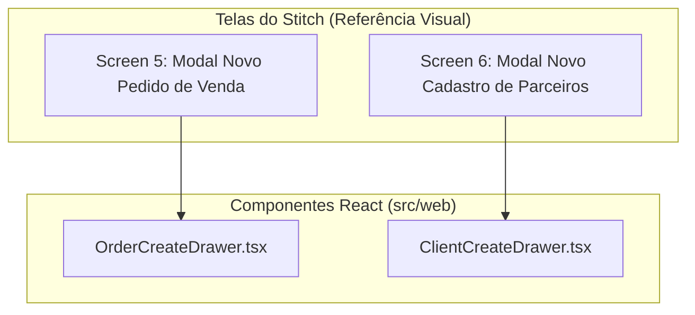

# Plano de Implementação: Modais Modernos de Cadastro (Stitch Apex Log WMS)

> **Projeto Stitch:** `Sistema Integrado de Estoque` (ID: `8619206087892575043`)  
> **Telas Mapeadas:**
> 1. `Modal Moderno: Novo Pedido de Venda` (ID: `39a5b6615f9b41da942df7fa4c0e2123`)  
> 2. `Modal Moderno: Novo Cadastro de Parceiros` (ID: `f58764fa090141bd97e604ee84ca9161`)  
> **Arquivos Locais Baixados:**
> - [screen5_modal_pedido.html](file:///c:/Users/Eduardo/Desktop/exemplo/sistema_almoxarifado/docs/stitch_reference/screen5_modal_pedido.html) & `screen5_modal_pedido.png`
> - [screen6_modal_parceiro.html](file:///c:/Users/Eduardo/Desktop/exemplo/sistema_almoxarifado/docs/stitch_reference/screen6_modal_parceiro.html) & `screen6_modal_parceiro.png`

---

## 1. Visão Geral da Modernização

Os novos designs de modal do Stitch trazem a experiência de **painéis industriais inteligentes de alto rendimento (WMS Enterprise)**:
- **Painéis Deslizantes com Largura Aumentada:** Melhor aproveitamento de espaço em desktops e tablets para preenchimento ágil sem aperto visual.
- **Conferência em Tempo Real:** Verificação imediata do saldo físico disponível, estoque de segurança e localização física antes de adicionar qualquer item à lista.
- **Segmented Tabs e Marcadores de Seção:** Organização em blocos lógicos (`Identificação & Sefaz`, `Contatos`, `Endereço`) com barras verticais coloridas de destaque.
- **Badges Inteligentes de Estoque:** Indicação visual nítida por item (`Saldo Imediato Disponível` em verde vs `Alerta de Déficit de Estoque` em vermelho).

---

## 2. Mapa de Modais Stitch vs Componentes React

---

## 3. Detalhamento e Matriz de Adaptação de Campos

### 3.1. Modal de Novo Pedido de Venda ([OrderCreateDrawer.tsx](file:///c:/Users/Eduardo/Desktop/exemplo/sistema_almoxarifado/src/web/components/gestao/vendas/OrderCreateDrawer.tsx))
- **Cabeçalho:**
  - Ícone corporativo de compras (`shopping_cart_checkout`) com fundo `bg-primary text-on-primary rounded-xl`.
  - Título `font-headline text-lg font-bold text-on-surface` com badge `WMS Sincronizado`.
- **Seção 1: Cliente & Prazo de Entrega:**
  - Seletor de Cliente com informações de localização e tipo.
  - Seletor de Data de Entrega com cálculo de SLA em tempo real (`SLA: X dias`).
  - Campo de observações de expedição.
- **Seção 2: Adicionador Rápido de Itens com Consulta de Saldo em Tempo Real:**
  - Dropdown agrupado por categorias de catálogo (`Matéria-prima`, `Peças & Componentes`, `Improdutivos`).
  - Painel de telemetria do produto selecionado:
    - Saldo Físico Atual com unidade (`kg`, `m`, `un`).
    - Alerta de Nível Mínimo se `saldo <= estoqueSeguranca`.
    - Localização física no almoxarifado.
  - Input numérico de quantidade demandada.
  - Botão `+ Adicionar à Lista`.
- **Seção 3: Grade de Itens Adicionados:**
  - Cards individuais de item com número sequencial (`01`, `02`), código SKU, descrição técnica.
  - Badge automático de status de reserva:
    - `Saldo Imediato Disponível` (quando saldo cobre a demanda).
    - `Alerta: Déficit de Estoque` (quando demanda excede o saldo).
  - Botão de exclusão da linha (`Trash2`).
- **Rodapé:**
  - Contador de linhas e unidades.
  - Botão `Salvar Pedido & Reservar Estoque`.

### 3.2. Modal de Novo Cadastro de Parceiros ([ClientCreateDrawer.tsx](file:///c:/Users/Eduardo/Desktop/exemplo/sistema_almoxarifado/src/web/components/gestao/clientes/ClientCreateDrawer.tsx))
- **Cabeçalho:**
  - Ícone corporativo `Users` em `bg-primary text-on-primary rounded-xl`.
  - Título `Novo Cadastro Comercial` com badge `WMS Homologado`.
- **Segmented Tabs no Topo:**
  - Pílulas de seleção de perfil: `Cliente`, `Fornecedor`, `Transportadora`, `Outro`.
- **Seções Estruturadas com Barras Laterais:**
  1. *Identificação:* Alternador de `Pessoa Jurídica (CNPJ)` vs `Pessoa Física (CPF)`, documento formatado com badge SEFAZ, Razão Social / Nome Completo.
  2. *Contatos & Responsáveis:* Nome do Contato Comercial, Telefone Comercial / WhatsApp em mono.
  3. *Localização:* Cidade / UF com ícone de localização.
- **Rodapé:**
  - Botão Cancelar e Botão `Salvar Cadastro & Homologar`.

---

## 4. Fases de Execução

1. **Fase 1: Modernização do Modal de Novo Pedido de Venda** ([OrderCreateDrawer.tsx](file:///c:/Users/Eduardo/Desktop/exemplo/sistema_almoxarifado/src/web/components/gestao/vendas/OrderCreateDrawer.tsx)) — **[CONCLUÍDO]**
   - Implementado layout amplo `max-w-2xl` com live lookup e consulta de saldo em tempo real.
   - Adicionados badges de disponibilidade/déficit e cards detalhados por linha de pedido com numeração `01`, `02`.
   - Compatibilidade total com `CreatePedidoSchema`.
2. **Fase 2: Modernização do Modal de Cadastro de Parceiros** ([ClientCreateDrawer.tsx](file:///c:/Users/Eduardo/Desktop/exemplo/sistema_almoxarifado/src/web/components/gestao/clientes/ClientCreateDrawer.tsx)) — **[CONCLUÍDO]**
   - Implementadas segmented tabs de perfil (`Cliente`, `Fornecedor`, `Transportadora`, `Contato`).
   - Adicionado alternador CNPJ/CPF com máscaras inteligentes, botão de consulta na Receita e seções estruturadas com barras coloridas.
   - Campos adicionais de Regime Tributário, Inscrição Estadual com badge de contribuinte, email para DANFE/EDI e banner de compliance.
   - Compatibilidade total com `CreateClienteSchema`.
3. **Fase 3: Validação de Tipos e Testes Automatizados** — **[CONCLUÍDO]**
   - Compilação estrita e build Next.js/Turbopack validados com `exit code 0`.
   - Suíte de testes unitários executada com 100% de aprovação.
