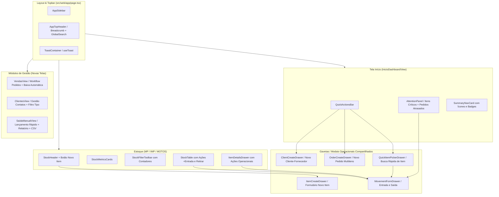
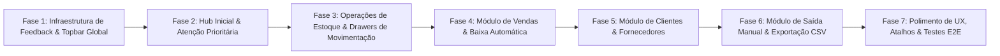

# Plano de Implementação: Paridade Funcional no Frontend React (`almoxarifado4.html` → React/Next.js)

## 1. Visão Geral e Objetivo

Este plano estabelece a estratégia técnica detalhada para elevar o frontend React em [src/web](file:///c:/Users/Eduardo/Desktop/exemplo/sistema_almoxarifado/src/web) à **paridade funcional e operacional absoluta** com o protótipo de alta fidelidade [almoxarifado4.html](file:///c:/Users/Eduardo/Desktop/exemplo/sistema_almoxarifado/Front%20end%20Almoxarifado/almoxarifado4.html).

### Metas Principais:
1. **Completude Operacional**: Eliminar todas as telas placeholder de gestão (`Vendas`, `Clientes`, `Saída manual`) transformando-as em módulos totalmente interativos.
2. **Ciclo Completo de Movimentação**: Implementar os fluxos de entrada de mercadorias (com validação de NF-e duplicada) e saída/retirada (com bloqueio por saldo insuficiente) tanto por atalhos diretos na tabela quanto no drawer de detalhes e na tela inicial.
3. **Catálogo Dinâmico**: Permitir a criação de novos materiais com atributos técnicos especializados por categoria (`Matéria-prima`, `Improdutivos`, `Peças de motos`).
4. **Hub de Produtividade & Busca Global**: Disponibilizar o Header com breadcrumbs, atalho `/` ou `Ctrl+K` para busca multifuncional em tempo real e o painel de atenção imediata na tela de Início.
5. **Excelência de UX & Feedback**: Adicionar sistema global de notificações *toast*, exportador CSV compatível com Excel e suporte a teclado/acessibilidade.

---

## 2. Arquitetura da Solução e Componentização



---

## 3. Estrutura de Arquivos Proposta

```text
src/
├── core/
│   └── domain/
│       ├── cliente.schema.ts              # Já existente (ClienteSchema, TipoParceiro)
│       ├── pedido.schema.ts               # Já existente (PedidoSchema, ItemPedidoSchema)
│       └── item.schema.ts                 # Já existente (CreateItemSchema, ItemSchema)
├── web/
│   ├── app/
│   │   ├── api/
│   │   │   ├── clientes/
│   │   │   │   └── route.ts               # [NOVO] GET / POST para clientes e parceiros
│   │   │   ├── pedidos/
│   │   │   │   ├── route.ts               # [NOVO] GET / POST para pedidos de venda
│   │   │   │   └── [id]/
│   │   │   │       └── route.ts           # [NOVO] PATCH para transição de status (SEPARADO / ENTREGUE)
│   │   │   ├── itens/route.ts             # Já existente (GET / POST)
│   │   │   └── movimentacoes/             # Já existente (entrada, baixa-interna, expedicao, extrato)
│   │   ├── page.tsx                       # Orquestrador de telas e gavetas globais
│   │   └── globals.css                    # Animações de toast e transições
│   ├── components/
│   │   ├── layout/
│   │   │   ├── AppSidebar.tsx             # Atualizar: badge no 'Início' quando houver atrasos
│   │   │   ├── AppTopHeader.tsx           # [NOVO] Header com breadcrumbs dinâmicos e busca global
│   │   │   └── GlobalSearchModal.tsx      # [NOVO] Dropdown de pesquisa híbrida (Itens, NFe, Clientes, Pedidos)
│   │   ├── feedback/
│   │   │   ├── ToastContainer.tsx         # [NOVO] Container e notificação flutuante tipo toast
│   │   │   └── EmptyState.tsx             # Já existente
│   │   ├── dashboard/
│   │   │   ├── inicio/
│   │   │   │   ├── InicioDashboardView.tsx # Atualizar com QuickActions e AttentionPanel
│   │   │   │   ├── QuickActionsBar.tsx    # [NOVO] 4 botões de ação imediata
│   │   │   │   ├── AttentionPanel.tsx     # [NOVO] Lista itens críticos e pedidos atrasados
│   │   │   │   └── SummaryNavCard.tsx     # Atualizar: adicionar ícones temáticos
│   │   │   ├── drawers/
│   │   │   │   ├── ItemCreateDrawer.tsx   # [NOVO] Formulário para criar item por categoria
│   │   │   │   ├── MovementFormDrawer.tsx # [NOVO] Registro de Entrada (NFe) ou Saída (Produção)
│   │   │   │   └── QuickItemPickerDrawer.tsx # [NOVO] Seletor rápido de produto com busca
│   │   │   ├── ItemDetailsDrawer.tsx      # Atualizar: botões de ação "+ Entrada" e "Retirar"
│   │   │   ├── StockTable.tsx             # Atualizar: botões contextuais por linha
│   │   │   └── StockFilterToolbar.tsx     # Atualizar: badges de contagem nos chips
│   │   ├── gestao/
│   │   │   ├── vendas/
│   │   │   │   ├── VendasView.tsx         # [NOVO] Tela principal de vendas e pedidos
│   │   │   │   ├── OrderStatusBadge.tsx   # [NOVO] Badges Pendente, Separado, Entregue, Atrasado
│   │   │   │   └── OrderCreateDrawer.tsx  # [NOVO] Drawer de criação de pedido com itens dinâmicos
│   │   │   ├── clientes/
│   │   │   │   ├── ClientesView.tsx       # [NOVO] Tela principal de clientes e parceiros
│   │   │   │   └── ClientCreateDrawer.tsx # [NOVO] Drawer de cadastro de cliente/fornecedor
│   │   │   └── saida/
│   │   │       ├── SaidaManualView.tsx    # [NOVO] Lançamento rápido + Relatório + Extrato
│   │   │       └── exportCsv.ts           # [NOVO] Utilitário de exportação para Excel UTF-8 BOM
│   ├── hooks/
│   │   ├── useToast.ts                    # [NOVO] Hook e store de notificações toast
│   │   ├── useGlobalSearch.ts             # [NOVO] Hook de busca unificada nas 4 entidades
│   │   ├── usePedidos.ts                  # [NOVO] Hook TanStack Query para pedidos
│   │   ├── useClientes.ts                 # [NOVO] Hook TanStack Query para clientes
│   │   ├── useMovimentacoesPeriodo.ts     # [NOVO] Hook para relatório e extrato de saída manual
│   │   ├── useItensEstoque.ts             # Já existente (adicionar mutation de criação)
│   │   └── useDashboardResumo.ts          # Já existente
```

---

## 4. Fases Sequenciais de Implementação



---

### Fase 1: Infraestrutura de Feedback (Toast) e Topbar Global com Busca Híbrida

#### Objetivos:
- Criar a camada global de notificação por *toast* flutuante.
- Inserir a Topbar fixa contendo *Breadcrumb* contextual e *Busca Geral* com atalho `/` e `Ctrl+K`.

#### Passos de Implementação:
1. **Toast System (`src/web/hooks/useToast.ts` e `ToastContainer.tsx`)**:
   - Criar store leve (Zustand ou React Context) para enfileirar mensagens temporárias de 3,2 segundos.
   - Componente visual estilizado: cápsula flutuante inferior centralizada, fundo escuro (`var(--ink)`), suporte a modo claro/escuro e animação suave `slide-up`.
2. **Topbar Component (`AppTopHeader.tsx`)**:
   - Inserir no topo de [page.tsx](file:///c:/Users/Eduardo/Desktop/exemplo/sistema_almoxarifado/src/web/app/page.tsx).
   - Renderizar o *Breadcrumb* baseado em `telaAtiva`:
     - Se `inicio`: `Início` (em negrito).
     - Se `mp` / `imp` / `motos`: `<button onClick="irInicio">Início</button> › Estoque › <b>Nome da Aba</b>`.
     - Se `vendas` / `clientes` / `saida`: `<button onClick="irInicio">Início</button> › Gestão › <b>Nome da Tela</b>`.
   - Mover o `ThemeToggle` para a Topbar ao lado do perfil ou busca, mantendo acesso em todas as telas.
3. **Barra de Busca Global (`GlobalSearchModal.tsx` e `useGlobalSearch.ts`)**:
   - Input com placeholder: `Buscar item, cliente, pedido ou NF-e ( / )`.
   - Listener de teclado global: tecla `/` (quando foco não estiver em inputs/textareas) ou atalho `Ctrl+K` / `Cmd+K` para focar o input.
   - Algoritmo de busca agregada com debounce de 200ms:
     - Consulta itens (código, nome, categoria, especificações).
     - Consulta movimentações recentes buscando por campo `nfe` ou `numeroNotaFiscal`.
     - Consulta clientes (nome, documento, contato).
     - Consulta pedidos (código `#ID`, cliente).
   - Dropdown flutuante com grupos estilizados:
     - Clique em **Item**: abre a aba do produto e dispara o drawer de detalhes.
     - Clique em **NF-e**: abre o item correspondente daquela remessa.
     - Clique em **Cliente**: navega para a tela de Clientes.
     - Clique em **Pedido**: navega para a tela de Vendas.
   - Tecla `Escape` fecha o dropdown de busca.

---

### Fase 2: Hub Inicial e Painel Operacional "Precisa de Atenção"

#### Objetivos:
- Reestruturar o [InicioDashboardView.tsx](file:///c:/Users/Eduardo/Desktop/exemplo/sistema_almoxarifado/src/web/components/dashboard/inicio/InicioDashboardView.tsx) para oferecer atalhos imediatos e visibilidade das urgências do dia.

#### Passos de Implementação:
1. **Barra de Ações Rápidas (`QuickActionsBar.tsx`)**:
   - Inserir no topo da tela inicial:
     - `[Registrar entrada]`: Abre o drawer seletor de produtos no modo Entrada.
     - `[Registrar saída]`: Abre o drawer seletor de produtos no modo Saída.
     - `[Novo pedido]`: Abre o drawer de criação de pedido de venda.
     - `[Novo cadastro]`: Abre o drawer de cadastro de cliente/fornecedor.
2. **Painel "Precisa de Atenção" (`AttentionPanel.tsx`)**:
   - Integrar dados de alertas:
     - **Pedidos atrasados**: se `atrasados > 0`, exibir banner com contagem e botão `[Ver pedidos]` que leva para a tela de Vendas.
     - **Materiais em nível crítico ou de alerta**: calcular razão `estoqueAtual / estoqueSeguranca` e listar até os 6 itens mais urgentes.
     - Cada linha exibe: Nome do produto, aba de estoque, saldo atual vs mínimo, badge (`Crítico` ou `Abaixo do mínimo`), botão direto `[+ Entrada]` e link no nome para abrir drawer do item.
     - Empty state contextual: Se não houver pedidos atrasados nem itens críticos, exibir mensagem discreta `Tudo em dia por aqui.`.
3. **Evolução Visual dos Cards de Navegação (`SummaryNavCard.tsx`)**:
   - Adicionar os ícones temáticos Lucide correspondentes ao protótipo:
     - Matéria-prima (`Layers`), Improdutivos (`Wrench`), Peças de motos (`Bike`).
     - Vendas (`ShoppingCart`), Clientes (`Users`), Saída manual (`ArrowLeftRight`).
4. **Atualização da Barra Lateral (`AppSidebar.tsx`)**:
   - Adicionar badge na opção "Início" caso existam pedidos atrasados (`pedidosAtrasadosCount > 0`), mantendo coerência com o protótipo.

---

### Fase 3: Operações de Estoque e Formulários de Movimentação

#### Objetivos:
- Permitir que os operadores cadastrem novos materiais e registrem entradas e saídas físicas com validação de dados em tempo real.

#### Passos de Implementação:
1. **Drawer de Cadastro de Item (`ItemCreateDrawer.tsx`)**:
   - Acionado pelo botão no cabeçalho das abas: `[Nova matéria-prima]`, `[Novo material improdutivo]` ou `[Nova peça de moto]`.
   - Campos comuns:
     - Descrição/Nome (obrigatório).
     - Código SKU (obrigatório com validação imediata de duplicidade).
     - Categoria.
     - Unidade de Medida (`un`, `kg`, `m`, `par`, `kit`, etc.).
     - Saldo Inicial, Estoque de Segurança (mínimo) e Capacidade Máxima.
   - Campos técnicos específicos por categoria:
     - *mp*: Lote, Certificado, NF-e, Fornecedor.
     - *imp*: Lote, Certificado de Aprovação (CA), NF-e, Fornecedor.
     - *motos*: Modelo compatível, Marca, Código original, Medida.
   - Conexão: Chama `POST /api/itens`, atualiza a lista via React Query e dispara notificação toast.
2. **Drawer de Entrada e Saída de Material (`MovementFormDrawer.tsx`)**:
   - Modo **Entrada**:
     - Data de chegada (padrão hoje, bloqueia datas futuras).
     - Quantidade e unidade de medida.
     - Campos técnicos (`NF-e`, `Fornecedor`, `Lote`, `Certificado`/`CA`).
     - Validação de duplicidade: bloqueia gravação se a mesma NF-e já tiver sido lançada anteriormente para o item.
     - Observações.
     - Conexão: Chama `POST /api/movimentacoes/entrada`, atualiza saldo do item e adiciona ao histórico.
   - Modo **Saída / Retirada**:
     - Data da retirada (padrão hoje).
     - Quantidade a debitar.
     - Validação impeditiva: Bloqueia retirada caso `quantidade > item.estoqueAtual`, exibindo erro claro na interface.
     - Campo "Retirado por / setor" (padrão "Produção").
     - Observações.
     - Conexão: Chama `POST /api/movimentacoes/baixa-interna`, atualiza saldo e extrato.
3. **Drawer Seletor Rápido de Item (`QuickItemPickerDrawer.tsx`)**:
   - Utilizado pelas ações rápidas da tela de Início.
   - Campo de pesquisa em tempo real por nome, código ou categoria.
   - Lista instantânea dos primeiros 30 itens com saldo e unidade.
   - Ao clicar em um item, abre o `MovementFormDrawer` já contextualizado.
4. **Atualizações na Tabela e Gaveta de Detalhes**:
   - [StockTable.tsx](file:///c:/Users/Eduardo/Desktop/exemplo/sistema_almoxarifado/src/web/components/dashboard/StockTable.tsx): Colocar botões `+ Entrada` e `Retirar` na coluna de ações de cada linha.
   - [ItemDetailsDrawer.tsx](file:///c:/Users/Eduardo/Desktop/exemplo/sistema_almoxarifado/src/web/components/dashboard/ItemDetailsDrawer.tsx): Inserir botões destacados `[Adicionar entrada]` e `[Retirar para produção]` no corpo do painel.
   - [StockFilterToolbar.tsx](file:///c:/Users/Eduardo/Desktop/exemplo/sistema_almoxarifado/src/web/components/dashboard/StockFilterToolbar.tsx): Adicionar contadores dinâmicos dentro de cada chip de situação (`Todos X`, `Normal Y`, `Abaixo do mínimo Z`, `Crítico W`).

---

### Fase 4: Módulo de Vendas, Workflows e Baixa Automática no Estoque

#### Objetivos:
- Substituir o placeholder do módulo de Vendas pela gestão operacional completa de pedidos a entregar, avanço de status e baixa automática.

#### Passos de Implementação:
1. **Rotas de Backend BFF (`src/web/app/api/pedidos`)**:
   - `GET /api/pedidos`: Lista pedidos com clientes resolvidos e itens detalhados.
   - `POST /api/pedidos`: Criação de novo pedido validando schema [PedidoSchema](file:///c:/Users/Eduardo/Desktop/exemplo/sistema_almoxarifado/src/core/domain/pedido.schema.ts).
   - `PATCH /api/pedidos/[id]`: Atualização de status operacional (`SEPARADO` ou `ENTREGUE`).
2. **Hook de Dados (`usePedidos.ts`)**:
   - Gerencia estado com TanStack Query, mutations para criar pedido e avançar status.
3. **Tela Principal de Vendas (`VendasView.tsx`)**:
   - Header com botão `[Novo pedido]` e subtítulo informativo.
   - 3 Cards de KPIs:
     - Pedidos a entregar (total com status diferente de `ENTREGUE`).
     - Atrasados (`prazoEntrega < dataHoje`).
     - Sem estoque suficiente (analisa se qualquer item do pedido possui `estoqueAtual < quantidadeRequisitada`).
   - Tabela de Pedidos:
     - Colunas: Pedido (`#ID`), Cliente, Lista de Itens (quantidade, unidade e nome), Prazo de Entrega (DD/MM/AAAA) e Situação.
     - Badges de situação: `Pendente` (azul), `Separado` (azul claro), `Entregue` (verde), além das tags `Atrasado` (vermelho) e `Falta estoque` (amarelo).
   - Fluxo de Ações:
     - Se `PENDENTE`: Botão `[Marcar separado]` avança o status para `SEPARADO`.
     - Se `SEPARADO`: Botão `[Entregar]` executa a validação de estoque:
       - Se houver item sem saldo: Exibe alerta impeditivo `Estoque insuficiente de [item] para o pedido #[ID]`.
       - Se houver estoque para todos os itens: Executa baixa automática chamando `POST /api/movimentacoes/expedicao` para cada item, atualiza o pedido para `ENTREGUE`, invalida queries de estoque e exibe confirmação toast.
4. **Drawer de Novo Pedido (`OrderCreateDrawer.tsx`)**:
   - Seleção do cliente a partir do cadastro de clientes ativos.
   - Data de entrega com seletor `<input type="date">`.
   - Adição dinâmica de linhas de produtos com botão `[+ Adicionar item]`:
     - Select com os produtos cadastrados agrupados por aba de estoque (`Matéria-prima`, `Improdutivos`, `Peças de moto`) e exibindo saldo atual.
     - Campo de quantidade.
   - Validações: Cliente obrigatório, data obrigatória e quantidades maiores que zero.

---

### Fase 5: Módulo de Clientes, Fornecedores e Contatos

#### Objetivos:
- Substituir o placeholder de Clientes por uma interface de consulta filtrada e cadastro de novos parceiros comerciais.

#### Passos de Implementação:
1. **Rotas de Backend BFF (`src/web/app/api/clientes`)**:
   - `GET /api/clientes`: Lista clientes e parceiros cadastrados no Firestore (coleção `clients`).
   - `POST /api/clientes`: Cria novo registro validando schema [ClienteSchema](file:///c:/Users/Eduardo/Desktop/exemplo/sistema_almoxarifado/src/core/domain/cliente.schema.ts).
2. **Hook de Dados (`useClientes.ts`)**:
   - Consulta e mutações para o catálogo de clientes.
3. **Tela Principal de Clientes (`ClientesView.tsx`)**:
   - Header com botão `[Novo cadastro]`.
   - Barra de filtros rápidos por tipo com chips: `Todos`, `Cliente`, `Fornecedor`, `Transportadora` e `Outro`.
   - Tabela de Parceiros:
     - Colunas: Nome ou Razão Social, Tipo (badge azul), CNPJ / CPF, Nome do Contato, Telefone e Cidade.
     - Empty states contextuais caso a categoria filtrada não possua registros.
4. **Drawer de Novo Cadastro (`ClientCreateDrawer.tsx`)**:
   - Formulário com campos:
     - Tipo (`CLIENTE`, `FORNECEDOR`, `TRANSPORTADORA`, `OUTRO`).
     - Razão Social / Nome (obrigatório).
     - CNPJ ou CPF.
     - Nome do Contato e Telefone.
     - Cidade.
   - Gravação com feedback imediato via toast e atualização reativa da lista.

---

### Fase 6: Módulo de Saída Manual, Relatórios Analíticos e Exportador CSV

#### Objetivos:
- Substituir o placeholder de Saída Manual por uma central de lançamentos avulsos, relatório sintético do período, extrato cronológico e exportação para CSV.

#### Passos de Implementação:
1. **Tela Principal de Saída Manual (`SaidaManualView.tsx`)**:
   - Header com botão `[Baixar relatório (CSV)]`.
2. **Painel de Lançamento Avulso ("Registrar movimentação")**:
   - Formulário embutido na parte superior com grade compacta:
     - Data (padrão hoje, limite máximo na data de hoje).
     - Tipo de Movimento (`Saída` ou `Entrada`).
     - Produto (select agrupado com indicação de saldo atual).
     - Quantidade.
     - Retirado por / setor (obrigatório).
     - Observações.
   - Validação imediata: se for Saída e a quantidade superar o saldo atual, exibe alerta e não permite envio.
3. **Relatório Sintético por Período**:
   - Campo de busca rápida por NF-e, lote, código, descrição do material ou responsável.
   - Chips de seleção de período: `Hoje`, `Ontem`, `7 dias` e `Tudo`.
   - Tabela sintética consolidada com cálculo dinâmico:
     - Colunas: Item (Nome, SKU, Categoria), Total Entrou (`+X un` em verde), Total Saiu (`−X un` em vermelho) e Estoque Atual.
4. **Extrato Cronológico Detalhado do Período**:
   - Lista sequencial das movimentações contendo: Item, Data e Hora (Hoje, Ontem ou DD/MM/AAAA), Responsável/Setor, Observações, Metadados fiscais (Lote, NF-e) e Quantidade com sinal e unidade.
5. **Utilitário de Exportação CSV (`exportCsv.ts`)**:
   - Gera arquivo `relatorio-movimentacoes.csv` contendo:
     - Colunas: `Data`, `Hora`, `Movimento`, `Código`, `Item`, `Quantidade`, `Unidade`, `Responsável`, `NF-e`, `Lote`, `Observação`.
     - Inclusão do byte order mark UTF-8 (`\ufeff`) e separador ponto e vírgula (`;`) para abertura automática perfeita no Microsoft Excel.

---

### Fase 7: Polimento de UX, Atalhos de Teclado, Acessibilidade e Testes

#### Objetivos:
- Garantir fluidez total de navegação, compatibilidade responsiva e cobertura de testes automatizados.

#### Passos de Implementação:
1. **Atalhos de Teclado e Foco Operacional**:
   - `/` ou `Ctrl+K`: Foca o campo de busca global.
   - `Escape`: Fecha qualquer modal, drawer aberto ou dropdown de pesquisa.
   - `Enter` na tabela: Abre o drawer de detalhes do item focado.
2. **Acessibilidade e Microanimações**:
   - Transições de drawer com `slide-in-from-right` e scrim suave.
   - Focus traps nos drawers para navegação por teclado (`Tab` / `Shift+Tab`).
   - Atributos `aria-expanded`, `aria-controls` e `role="dialog"` em todos os modais.
3. **Testes Automatizados**:
   - Testes unitários para cálculos de criticidade, validação de falta de estoque e exportação de CSV.
   - Testes de integração para as rotas BFF de `/api/pedidos` e `/api/clientes`.
   - Teste de fluxo completo de entrega de pedido com baixa automática no estoque.

---

## 5. Matriz de Rastreabilidade de Requisitos

| Funcionalidade do Protótipo (`almoxarifado4.html`) | Componente React Planejado | Fase |
| :--- | :--- | :--- |
| Busca Global com `/` e atalhos | `AppTopHeader` + `GlobalSearchModal` | Fase 1 |
| Notificações Toast nativas | `ToastContainer` + `useToast` | Fase 1 |
| Breadcrumbs dinâmicos no topo | `AppTopHeader` | Fase 1 |
| Ações rápidas no início (Entrada, Saída, Pedido, Cadastro) | `QuickActionsBar` | Fase 2 |
| Painel "Precisa de Atenção" com lista e pedidos atrasados | `AttentionPanel` | Fase 2 |
| Ícones estilizados nos cards de navegação | `SummaryNavCard` | Fase 2 |
| Cadastro de novo item com campos técnicos por categoria | `ItemCreateDrawer` | Fase 3 |
| Formulários de Entrada (NFe) e Saída (Produção) | `MovementFormDrawer` | Fase 3 |
| Seletor rápido de produto para movimentação | `QuickItemPickerDrawer` | Fase 3 |
| Botões `+ Entrada` e `Retirar` na tabela e no drawer | `StockTable` + `ItemDetailsDrawer` | Fase 3 |
| Contadores numéricos nos chips de filtro | `StockFilterToolbar` | Fase 3 |
| Módulo completo de Vendas com avanço de status e KPIs | `VendasView` + `OrderCreateDrawer` | Fase 4 |
| Baixa automática de estoque ao entregar pedido | `VendasView` + `/api/movimentacoes/expedicao` | Fase 4 |
| Módulo completo de Clientes com filtro por tipo | `ClientesView` + `ClientCreateDrawer` | Fase 5 |
| Módulo de Saída Manual com formulário rápido | `SaidaManualView` | Fase 6 |
| Relatório sintético e extrato por período | `SaidaManualView` | Fase 6 |
| Exportação de relatório em CSV compatível com Excel | `exportCsv.ts` | Fase 6 |
| Atalhos globais de teclado (`/`, `Ctrl+K`, `Enter`, `Esc`) | Handlers globais em `page.tsx` | Fase 7 |

---

## 6. Próximos Passos Recomendados

Para iniciar a execução deste plano, a sequência de entrega sugerida é:
1. **Aprovação do Plano**: Validação da ordem das fases e prioridades operacionais.
2. **Execução da Fase 1**: Criação do sistema de Toast e Topbar Global com Busca Integrada.
3. **Execução das Fases 2 e 3**: Hub Inicial com Ações Rápidas e Drawers Operacionais de Movimentação/Cadastro.
4. **Execução das Fases 4, 5 e 6**: Telas de Gestão (Vendas, Clientes e Saída Manual).
