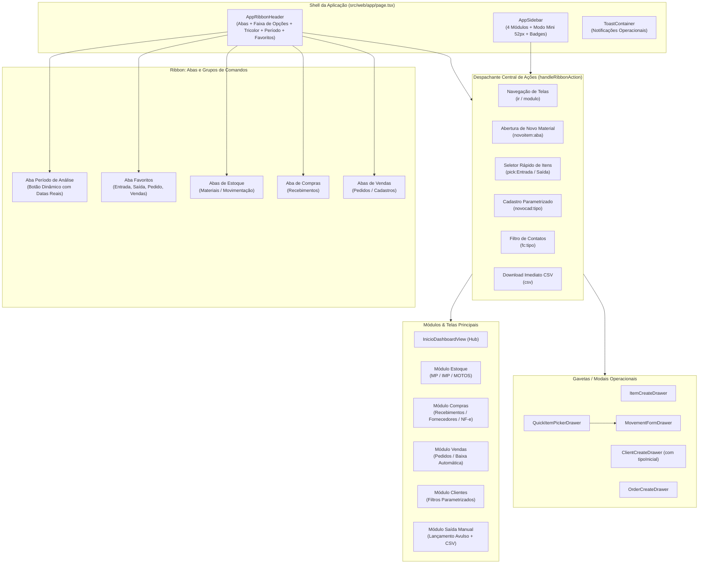

# Plano de Implementação: Paridade Funcional com Protótipo v5 (`almoxarifado5.html` → React/Next.js)

## 1. Visão Geral e Objetivos

Este plano define as etapas técnicas detalhadas para implementar no frontend React ([src/web](file:///c:/Users/Eduardo/Desktop/exemplo/sistema_almoxarifado/src/web)) todas as funcionalidades, fluxos e elementos visuais introduzidos no protótipo [almoxarifado5.html](file:///c:/Users/Eduardo/Desktop/exemplo/sistema_almoxarifado/Front%20end%20Almoxarifado/almoxarifado5.html).

### Metas Principais:
1. **Faixa de Opções (Ribbon Menu)**: Substituir o cabeçalho simples pelo componente `AppRibbonHeader`, contendo abas superiores, faixa de ferramentas estilo Office/ERP com ícones 30px em botões verticais, grupos contextuais e barra tricolor corporativa contínua.
2. **Sidebar Retrátil de Módulos Corporativos**: Evoluir o `AppSidebar` para organizar a aplicação em 4 grandes módulos (`Início`, `Estoque`, `Compras`, `Vendas`), com botão de alternância para modo colapsado mini (52px).
3. **Módulo de Compras Integrado**: Criar a experiência completa do módulo de Compras, integrando fluxos de recebimento de materiais, atalhos diretos para fornecedores e extrato de entradas por NF-e.
4. **Controle Global do Período de Análise**: Centralizar o estado do período analítico na Ribbon, com alternância circular e cálculo em tempo real do intervalo textual formatado ("08/10/2026 à 14/10/2026").
5. **Aba Global de Favoritos**: Disponibilizar atalhos imediatos na barra superior para as ações mais frequentes do almoxarifado.
6. **Ações Parametrizadas e Deep Linking Interno**: Permitir que botões da Ribbon abram cadastros já configurados (`tipoInicial = 'FORNECEDOR'`), filtrem telas automaticamente (`filtroInicial = 'FORNECEDOR'`) ou disparem o download de CSV de qualquer tela.

---

## 2. Arquitetura da Solução e Componentização



---

## 3. Matriz de Arquivos Afetados

| Arquivo | Ação | Responsabilidade |
| :--- | :--- | :--- |
| [src/web/data/mock-almoxarifado.ts](file:///c:/Users/Eduardo/Desktop/exemplo/sistema_almoxarifado/src/web/data/mock-almoxarifado.ts) | Modificar | Adicionar tipos de módulos corporativos (`ModuloCorporativo`), novos comandos de Ribbon e metadados. |
| [src/web/components/layout/AppRibbonHeader.tsx](file:///c:/Users/Eduardo/Desktop/exemplo/sistema_almoxarifado/src/web/components/layout/AppRibbonHeader.tsx) | Criar | Componente da Ribbon Bar (abas superiores, botões verticais 88px, ícones 30px, grupos `.grp2` e faixa tricolor). |
| [src/web/components/layout/AppSidebar.tsx](file:///c:/Users/Eduardo/Desktop/exemplo/sistema_almoxarifado/src/web/components/layout/AppSidebar.tsx) | Modificar | Implementar botão de recolhimento (`#modtog`), modo mini colapsado (52px) e reorganização em 4 módulos. |
| [src/web/components/gestao/clientes/ClientCreateDrawer.tsx](file:///c:/Users/Eduardo/Desktop/exemplo/sistema_almoxarifado/src/web/components/gestao/clientes/ClientCreateDrawer.tsx) | Modificar | Adicionar suporte à prop `tipoInicial?: TipoParceiro` para pré-seleção dinâmica no formulário. |
| [src/web/components/gestao/clientes/ClientesView.tsx](file:///c:/Users/Eduardo/Desktop/exemplo/sistema_almoxarifado/src/web/components/gestao/clientes/ClientesView.tsx) | Modificar | Aceitar `filtroInicial?: TipoParceiro \| 'TODOS'` via prop para sincronização com atalhos da Ribbon. |
| [src/web/hooks/usePeriodoGlobal.ts](file:///c:/Users/Eduardo/Desktop/exemplo/sistema_almoxarifado/src/web/hooks/usePeriodoGlobal.ts) | Criar | Hook centralizado para controle do período ativo e formatação da string de intervalo legível. |
| [src/web/app/page.tsx](file:///c:/Users/Eduardo/Desktop/exemplo/sistema_almoxarifado/src/web/app/page.tsx) | Modificar | Integrar `AppRibbonHeader`, gerenciar estado de módulos, despachante de ações da Ribbon e modo mini da sidebar. |

---

## 4. Fases Detalhadas de Implementação

### Fase 1: Modelagem de Dados e Tipos para Módulos e Ribbon

**Objetivo**: Expandir o sistema de tipos para suportar módulos corporativos, abas da Ribbon e comandos do despachante.

1. **Alterar [src/web/data/mock-almoxarifado.ts](file:///c:/Users/Eduardo/Desktop/exemplo/sistema_almoxarifado/src/web/data/mock-almoxarifado.ts)**:
   - Definir o tipo `ModuloCorporativo = 'inicio' | 'estoque' | 'compras' | 'vendas'`.
   - Definir a estrutura de comandos da Ribbon:
```typescript
export type ModuloCorporativo = 'inicio' | 'estoque' | 'compras' | 'vendas';

export interface RibbonButtonDef {
  action: string;      // Ex: 'v:mp', 'novoitem:mp', 'pick:Entrada', 'fc:Fornecedor', 'csv'
  label: string;       // Ex: 'Matéria-prima', 'Receber material'
  icon: string;        // Identificador do ícone
}

export interface RibbonGroupDef {
  title: string;       // Ex: 'Consulta', 'Cadastro', 'Entregas'
  buttons: RibbonButtonDef[];
}

export interface RibbonTabDef {
  name: string;        // Ex: 'Materiais', 'Movimentação', 'Recebimentos'
  groups: RibbonGroupDef[];
}
```
   - Definir a constante de configuração de módulos idêntica à do protótipo v5 (`MOD_DEFINITIONS`):
     - **Estoque**: abas `Materiais` e `Movimentação`.
     - **Compras**: aba `Recebimentos`.
     - **Vendas**: abas `Pedidos` e `Cadastros`.

---

### Fase 2: Hook Centralizado de Período Global (`usePeriodoGlobal`)

**Objetivo**: Disponibilizar o estado do período analítico e a formatação textual exata das datas reais ("08/10/2026 à 14/10/2026") para uso tanto na Ribbon quanto em `SaidaManualView`.

1. **Criar [src/web/hooks/usePeriodoGlobal.ts](file:///c:/Users/Eduardo/Desktop/exemplo/sistema_almoxarifado/src/web/hooks/usePeriodoGlobal.ts)**:
   - Gerenciar `periodo: 'Hoje' | 'Ontem' | '7 dias' | 'Tudo'`.
   - Implementar cálculo de datas:
     - Formatação brasileira `DD/MM/AAAA`.
     - `hoje()` e `ontem()`.
     - `diaAntes(6)` para o intervalo de 7 dias móveis.
   - Fornecer a função `proximoPeriodo()` para ciclar quando o botão da Ribbon for clicado.
   - Fornecer a propriedade `textoIntervalo`:
```typescript
export function usePeriodoGlobal() {
  const [periodo, setPeriodo] = useState<PeriodoFiltro>('Hoje');

  const textoIntervalo = useMemo(() => {
    if (periodo === 'Tudo') return 'todo o histórico';
    if (periodo === 'Hoje') return formatarDataBR(hoje());
    if (periodo === 'Ontem') return formatarDataBR(ontem());
    return `${formatarDataBR(diaAntes(6))} à ${formatarDataBR(hoje())}`;
  }, [periodo]);

  const proximoPeriodo = () => {
    const periodos: PeriodoFiltro[] = ['Hoje', 'Ontem', '7 dias', 'Tudo'];
    const proximo = periodos[(periodos.indexOf(periodo) + 1) % periodos.length];
    setPeriodo(proximo);
  };

  return { periodo, setPeriodo, textoIntervalo, proximoPeriodo };
}
```

---

### Fase 3: Construção do Componente `AppRibbonHeader`

**Objetivo**: Implementar a Faixa de Opções completa de alta fidelidade visual com `almoxarifado5.html`.

1. **Criar [src/web/components/layout/AppRibbonHeader.tsx](file:///c:/Users/Eduardo/Desktop/exemplo/sistema_almoxarifado/src/web/components/layout/AppRibbonHeader.tsx)**:
   - **Camada Superior (`.tabs`)**:
     - Botão quadrado de logotipo `.logo2` com a letra **A**, cor de marca e clique direto para navegar para `inicio`.
     - Abas dinâmicas em linha com seleção por clique:
       - Aba `Período de Análise` (com ícone de calendário).
       - Aba `Favoritos`.
       - Abas contextuais do módulo ativo (ex: `Materiais` e `Movimentação` para Estoque).
     - Input de Busca Global [GlobalSearchInput.tsx](file:///c:/Users/Eduardo/Desktop/exemplo/sistema_almoxarifado/src/web/components/layout/GlobalSearchInput.tsx) posicionado à direita da linha de abas.
     - Botão [ThemeToggle.tsx](file:///c:/Users/Eduardo/Desktop/exemplo/sistema_almoxarifado/src/web/components/layout/ThemeToggle.tsx) integrado.
   - **Camada Inferior (`.ribbon`)**:
     - Container flex com rolagem horizontal suave e altura fixa de 96px.
     - Grupos funcionais verticais com divisória lateral (`border-r border-slate-200 dark:border-slate-800`).
     - Botões da Ribbon estilizados:
       - Largura fixa de 88px, centralizados, com flex column.
       - Ícone SVG destacado (30x30px) com cor azul celeste (`#4fa8e0` / `var(--sky)`).
       - Texto em 2 linhas, tipografia compacta e alinhada ao centro.
       - Hover com fundo translúcido e borda sutil.
     - **Comportamento das Abas Fixas**:
       - *Período de Análise*: Exibe o botão com rótulo formatado em 2 linhas: `Período: ${periodo}` e `${textoIntervalo}`. Clicar aciona `proximoPeriodo()`.
       - *Favoritos*: Exibe o grupo `Atalhos` com: `Adicionar entrada`, `Retirar para produção`, `Novo pedido`, `Pedidos a entregar`.
   - **Borda Decorativa Tricolor**:
     - Implementar o elemento `.rib::after` com o gradiente exato:
       `linear-gradient(90deg, #4fa8e0 0 55%, #d9372f 55% 78%, #f2b705 78%)` e altura de 3px.

---

### Fase 4: Sidebar Retrátil de Módulos (`AppSidebar` Mini-Mode)

**Objetivo**: Implementar os 4 módulos corporativos e o botão de toggle para recolher/expandir a barra lateral.

1. **Alterar [src/web/components/layout/AppSidebar.tsx](file:///c:/Users/Eduardo/Desktop/exemplo/sistema_almoxarifado/src/web/components/layout/AppSidebar.tsx)**:
   - Adicionar estado `isMini` (persistível no `localStorage` ou controlado por prop).
   - Cabeçalho da sidebar com título "Módulos" e botão de toggle:
     - Ícone `ChevronLeft` quando expandido; `ChevronRight` quando recolhido.
   - Larguras:
     - Expandido: `w-[178px]` ou `md:w-56`.
     - Mini: `w-[52px]` ou `md:w-16`.
   - Botões de Módulo:
     1. **Início** (ícone Home).
     2. **Estoque** (ícone Caixa/Layers + Badge vermelha se houver itens críticos).
     3. **Compras** (ícone Recebimento/Download).
     4. **Vendas** (ícone Carrinho + Badge vermelha se houver pedidos atrasados).
   - No modo mini:
     - Ocultar textos e badges através de classes condicionais.
     - Centralizar ícones com `tooltip` flutuante no hover.

---

### Fase 5: Parametrização dos Drawers e Sincronização de Filtros

**Objetivo**: Permitir que os botões da Ribbon abram formulários já parametrizados.

1. **Alterar [src/web/components/gestao/clientes/ClientCreateDrawer.tsx](file:///c:/Users/Eduardo/Desktop/exemplo/sistema_almoxarifado/src/web/components/gestao/clientes/ClientCreateDrawer.tsx)**:
   - Adicionar prop `tipoInicial?: TipoParceiro` na interface:
```typescript
export interface ClientCreateDrawerProps {
  isOpen: boolean;
  onClose: () => void;
  onClientCreated?: () => void;
  tipoInicial?: TipoParceiro;
}
```
   - No `useEffect`, inicializar `setTipo(tipoInicial || 'CLIENTE')`.

2. **Alterar [src/web/components/gestao/clientes/ClientesView.tsx](file:///c:/Users/Eduardo/Desktop/exemplo/sistema_almoxarifado/src/web/components/gestao/clientes/ClientesView.tsx)**:
   - Adicionar prop `filtroInicial?: TipoParceiro | 'TODOS'` na interface:
```typescript
export interface ClientesViewProps {
  onNovoCadastro: (tipo?: TipoParceiro) => void;
  filtroInicial?: TipoParceiro | 'TODOS';
}
```
   - Sincronizar o estado interno `filtroTipo` com `filtroInicial` quando fornecido.

---

### Fase 6: Despachante Central de Ações no `page.tsx`

**Objetivo**: Integrar todas as partes no layout principal [src/web/app/page.tsx](file:///c:/Users/Eduardo/Desktop/exemplo/sistema_almoxarifado/src/web/app/page.tsx).

1. **Implementar a função `handleRibbonAction(acao: string)`**:
   - Tratamento de comandos prefixados:
     - `v:view`: `handleSelectTela(view)`.
     - `novoitem:aba`: define a aba ativa de estoque e abre `setIsItemCreateOpen(true)`.
     - `pick:Tipo`: abre `setPickerDrawerState({ isOpen: true, tipo })`.
     - `novopedido`: abre `setIsOrderCreateOpen(true)`.
     - `novocad:Tipo`: abre `setIsClientCreateOpen(true)` passando `tipoInicial` correspondente.
     - `fc:Tipo`: navega para `clientes` com o filtro pré-aplicado.
     - `csv`: executa a função de exportação de CSV do período ativo.
     - `per`: avança o período global.
2. **Gerenciamento de Módulo Ativo e Procedência (`modDe`)**:
   - Manter o estado `moduloAtivo: ModuloCorporativo`.
   - Ao selecionar um módulo na sidebar:
     - `estoque`: abre a aba `mp` e ajusta as abas da Ribbon para Materiais.
     - `compras`: abre a view `saida` e ajusta as abas da Ribbon para Recebimentos.
     - `vendas`: abre a view `vendas` e ajusta as abas da Ribbon para Pedidos.
     - `inicio`: abre a tela inicial.

---

## 5. Estratégia de Testes e Validação

### Testes Automatizados (Vitest / Testing Library)
1. **Teste do `AppRibbonHeader`**:
   - Verificar renderização de abas e grupos conforme o módulo ativo.
   - Verificar clique no botão de período ciclando entre `Hoje`, `Ontem`, `7 dias` e `Tudo`.
   - Testar disparo dos comandos da Ribbon (`data-rb`).
2. **Teste do `AppSidebar` Mini-Mode**:
   - Verificar alternância de largura entre normal (178px) e mini (52px).
   - Verificar ocultamento correto de rótulos e exibição de badges.
3. **Teste de Paridade de Cadastros**:
   - Validar abertura de `ClientCreateDrawer` com `tipoInicial = 'FORNECEDOR'`.
   - Validar abertura com `tipoInicial = 'CLIENTE'`.
4. **Teste de Fluxo de Compras**:
   - Testar clique em Compras → Receber material abrindo o seletor em modo Entrada.
   - Testar clique em Compras → Fornecedores aplicando filtro imediato na tela de clientes.

### Validação Visual e Responsiva
- Inspecionar layout desktop (> 860px) com Ribbon e Sidebar mini/expandida.
- Inspecionar layout tablet/mobile (< 860px) com scroll horizontal na Ribbon e na barra de módulos.
- Validar contraste nos modos Claro e Escuro com a paleta de variáveis e a faixa tricolor.

---

## 6. Critérios de Aceitação (Checklist de Paridade)

- [ ] A barra superior exibe a **Ribbon Bar** completa com abas superiores, botões verticais com ícones de 30px e a borda tricolor decorativa contínua.
- [ ] A sidebar suporta o botão de recolhimento (`#modtog`), alternando perfeitamente entre 178px e 52px.
- [ ] O módulo **Compras** é navegável e disponibiliza seus atalhos de recebimento, fornecedores e relatórios de NF-e.
- [ ] O **Período de Análise** pode ser alternado pela Ribbon e exibe o intervalo calculado com datas reais formatadas.
- [ ] A aba **Favoritos** da Ribbon disponibiliza as 4 ações prioritárias em qualquer tela.
- [ ] O botão "Novo fornecedor" abre o cadastro com a opção "Fornecedor" já selecionada.
- [ ] O botão "Baixar CSV" na Ribbon dispara o download imediato da planilha sem necessidade de abrir a tela de saída manual.
- [ ] O atalho da logo (`.logo2`) no topo esquerdo retorna à tela inicial de qualquer lugar da aplicação.
