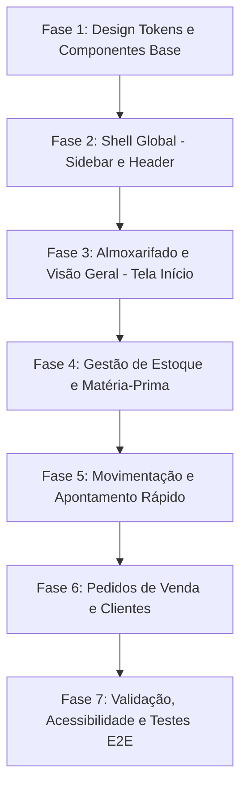

# Plano de Implementação: Modernização do Frontend React com Base no Design Stitch (Apex Log WMS)

> **Documento de Especificação Técnica e Plano de Execução**  
> **Origem do Design:** Stitch Project `Sistema Integrado de Estoque` (ID: `8619206087892575043`)  
> **Destino:** Frontend React / Next.js (`src/web`) do Sistema de Almoxarifado Integrado  
> **Arquivos de Referência Baixados:** [docs/stitch_reference/](file:///c:/Users/Eduardo/Desktop/exemplo/sistema_almoxarifado/docs/stitch_reference) (`screen1_movimentacao.html`, `screen2_pedidos.html`, `screen3_estoque.html`, `screen4_almoxarifado.html`)  
> **Screenshots de Referência:** [docs/stitch_reference/](file:///c:/Users/Eduardo/Desktop/exemplo/sistema_almoxarifado/docs/stitch_reference) (`screen1_movimentacao.png`, `screen2_pedidos.png`, `screen3_estoque.png`, `screen4_almoxarifado.png`)  
> **Data:** 14 de Outubro de 2026

---

## 1. Visão Geral e Alinhamento Estratégico

O design gerado pelo Stitch apresenta um salto de maturidade visual, ergonomia industrial e sofisticação de software corporativo padrão WMS Enterprise ("Apex Log WMS"). 

O objetivo deste plano é **incorporar 100% do design, paleta, ritmo tipográfico e hierarquia visual criados pelo Stitch**, porém **adaptando-os com fidelidade aos campos reais do nosso banco Firestore, à arquitetura Next.js/React e às regras de negócio do nosso sistema de almoxarifado**.

```
┌────────────────────────────────────────────────────────────────────────────────────────┐
│                                 MAPA DE CONVERGÊNCIA                                  │
├─────────────────────────────────────────┬──────────────────────────────────────────────┤
│ TELA STITCH (Referência Visual)        │ TELA / COMPONENTE NO REACT                   │
├─────────────────────────────────────────┼──────────────────────────────────────────────┤
│ Screen 4: Almoxarifado & Visão Geral    │ src/web/components/dashboard/inicio/         │
│ (ID: 65870c608464495cbf06d139ef23bbda)  │ InicioDashboardView.tsx                      │
├─────────────────────────────────────────┼──────────────────────────────────────────────┤
│ Screen 3: Estoque & Matéria-Prima       │ src/web/components/dashboard/                │
│ (ID: b0b2c069bb9c4126a7b5fcbd6e6d7d2a)  │ StockTable.tsx + StockMetricsCards.tsx        │
├─────────────────────────────────────────┼──────────────────────────────────────────────┤
│ Screen 1: Movimentação & Apontamentos   │ src/web/components/gestao/saida/             │
│ (ID: 204b26d21a8040bb9bd730d15f5d1def)  │ SaidaManualView.tsx + MovementFormDrawer.tsx  │
├─────────────────────────────────────────┼──────────────────────────────────────────────┤
│ Screen 2: Pedidos de Venda & Clientes   │ src/web/components/gestao/vendas/            │
│ (ID: 8338defc7c234ffd89eed1803a3b4605)  │ VendasView.tsx + ClientesView.tsx            │
├─────────────────────────────────────────┼──────────────────────────────────────────────┤
│ Global Shell (Sidebar + Top Bar)        │ src/web/components/layout/                   │
│                                         │ AppSidebar.tsx + AppTopHeader.tsx            │
└─────────────────────────────────────────┴──────────────────────────────────────────────┘
```

---

## 2. Sistema de Design: Tokens, Cores e Tipografia

### 2.1. Paleta de Cores Material Design 3 Enterprise (Tailwind & CSS Tokens)

O Stitch adota a paleta cromática Material You / MD3 tonal palettes. Vamos expandir nosso [globals.css](file:///c:/Users/Eduardo/Desktop/exemplo/sistema_almoxarifado/src/web/app/globals.css) e `tailwind.config` com os tokens exatos:

```css
/* Tokens Stitch Enterprise no globals.css */
:root {
  /* Surfaces & Containers */
  --surface: #f8f9ff;
  --surface-bright: #f8f9ff;
  --surface-dim: #cbdbf5;
  --surface-container-lowest: #ffffff;
  --surface-container-low: #eff4ff;
  --surface-container: #e5eeff;
  --surface-container-high: #dce9ff;
  --surface-container-highest: #d3e4fe;
  
  /* Contrast Inverses (Sidebar e Badges) */
  --inverse-surface: #213145;
  --inverse-on-surface: #eaf1ff;
  
  /* Brand / Primary */
  --primary: #004ac6;
  --primary-container: #2563eb;
  --on-primary: #ffffff;
  --on-primary-container: #eeefff;
  
  /* Success / Operação Normal */
  --tertiary: #006329;
  --tertiary-container: #007f36;
  --tertiary-fixed: #7ffc97;
  --tertiary-fixed-dim: #62df7d;
  --on-tertiary: #ffffff;
  
  /* Warning & Ruptura Crítica */
  --error: #ba1a1a;
  --error-container: #ffdad6;
  --on-error: #ffffff;
  --on-error-container: #93000a;
  
  /* Secondary / Neutrals */
  --secondary: #565e74;
  --secondary-container: #dae2fd;
  --on-secondary-fixed: #131b2e;
  --outline: #737686;
  --outline-variant: #c3c6d7;
  --on-surface: #0b1c30;
  --on-surface-variant: #434655;
}

/* Modo Escuro Sincronizado */
.dark, :root[data-theme="dark"] {
  --surface: #0e1520;
  --surface-bright: #1b2636;
  --surface-dim: #0a0f18;
  --surface-container-lowest: #131c2a;
  --surface-container-low: #182333;
  --surface-container: #1e2c40;
  --surface-container-high: #24354c;
  --surface-container-highest: #2b3e58;
  --inverse-surface: #eaf1ff;
  --inverse-on-surface: #0b1c30;
  --on-surface: #eaf1ff;
  --on-surface-variant: #b0b8c6;
  --outline: #6c788d;
  --outline-variant: #344256;
}
```

### 2.2. Tipografia e Numerais Tabulares
- **Headlines & KPI Values:** `Plus Jakarta Sans` ou `IBM Plex Sans` (pesos 600, 700, 800) com espaçamento `-0.02em` para valores numéricos grandes de alta legibilidade.
- **Tabelas, Registros e Curingas:** `Inter` ou `IBM Plex Sans` com `font-variant-numeric: tabular-nums` para alinhamento perfeito de colunas de estoque, pesos e moedas.
- **Ícones:** Manter o pacote leve `lucide-react` atual mapeado para os equivalentes semânticos do Stitch, ou incluir a fonte oficial `Material Symbols Outlined` via [layout.tsx](file:///c:/Users/Eduardo/Desktop/exemplo/sistema_almoxarifado/src/web/app/layout.tsx).

---

## 3. Detalhamento Tela a Tela e Adaptação de Domínio

### 3.1. Shell Global: AppSidebar e AppTopHeader

#### Stitch (Screen 4 & Global):
- Sidebar fixa esquerda (`w-64`, `bg-inverse-surface`), logotipo com badge "AL" (Apex Log / WMS Enterprise), links verticais com ícones e badges de contagem de atenção (`3`, `14 críticos`, `8 pedidos`), e no rodapé um card de status do coletor ("Coletor RF Online").
- Top Bar (`h-16`, sticky, `bg-surface-container-lowest`), seletor de armazém ("Unidade Matriz - Galpão 01"), barra de pesquisa com atalho `⌘K`, data operacional ("24/10/2026"), sino de notificações com bolinha vermelha, e card de usuário ativo com avatar e status online.

#### Adaptação aos Nossos Campos e Sistema:
- **Sidebar ([AppSidebar.tsx](file:///c:/Users/Eduardo/Desktop/exemplo/sistema_almoxarifado/src/web/components/layout/AppSidebar.tsx)):**
  - **Menu Operacional:**
    1. *Início / Visão Geral* -> Rota/Tela `'inicio'` (badge com total de alertas urgentes).
    2. *Estoque & Almoxarifado* -> Subitens ou tela direta `'mp'` / `'imp'` / `'motos'` (badge com contagem real de críticos: `contagemCriticosGerais`).
    3. *Movimentações & Apontamentos* -> Tela `'saida'` (histórico de baixas e entradas rápidas).
    4. *Pedidos & Vendas* -> Tela `'vendas'` (badge de pedidos atrasados).
    5. *Compras & Fornecedores* -> Tela `'clientes'` filtrada por `FORNECEDOR`.
    6. *Clientes & Expedição* -> Tela `'clientes'` filtrada por `CLIENTE`.
  - **Rodapé:** Indicador de conexão com o Firebase Firestore ("Firestore Conectado" / "Terminal Sincronizado") com ponto verde de conectividade.
- **Header ([AppTopHeader.tsx](file:///c:/Users/Eduardo/Desktop/exemplo/sistema_almoxarifado/src/web/components/layout/AppTopHeader.tsx)):**
  - Seletor de Galpão/Unidade (preparado para multi-almoxarifado ou fixo "Galpão Principal - Fábrica").
  - [GlobalSearchInput.tsx](file:///c:/Users/Eduardo/Desktop/exemplo/sistema_almoxarifado/src/web/components/layout/GlobalSearchInput.tsx) com o layout do Stitch: input arredondado `bg-surface-container` e tecla `⌘K` integrada ao atalho existente.
  - Data Operacional dinâmica sincronizada com [usePeriodoGlobal.ts](file:///c:/Users/Eduardo/Desktop/exemplo/sistema_almoxarifado/src/web/hooks/usePeriodoGlobal.ts).
  - Usuário autenticado obtido do `useAuthStore` (nome, e-mail e papel "Gestor de Estoque" ou "Almoxarife").

---

### 3.2. Tela 1: Almoxarifado & Visão Geral (Início)
*Baseada na Screen 4 do Stitch (`screen4_almoxarifado.html`)*

#### Componente: [InicioDashboardView.tsx](file:///c:/Users/Eduardo/Desktop/exemplo/sistema_almoxarifado/src/web/components/dashboard/inicio/InicioDashboardView.tsx)

```
┌────────────────────────────────────────────────────────────────────────────────────────┐
│ TOP BAR: Almoxarifado & Visão Geral | Turno Atual | [Atualizar Dados] [Relatório]      │
├────────────────────────────────────────────────────────────────────────────────────────┤
│ QUICK ACTIONS RIBBON (4 botões em destaque):                                           │
│ [+ Registrar Entrada]   [- Registrar Saída/Baixa]   [+ Novo Pedido]   [+ Cadastrar Item]│
├────────────────────────────────────────────────────────────────────────────────────────┤
│ PRIORITY ALERT BANNER: Atenção Imediata Necessária (4 itens zerados, 2 pedidos em atraso)│
├────────────────────────────────────────────────────────────────────────────────────────┤
│ CATEGORY BALANCE CARDS (3 colunas):                                                    │
│ ┌──────────────────────┐  ┌──────────────────────┐  ┌──────────────────────┐          │
│ │ Matéria-prima        │  │ Improdutivos         │  │ Peças & Componentes  │          │
│ │ 152 itens | 68% Rupt.│  │ 89 itens | 41% Crít. │  │ 96 itens | 26% Crít. │          │
│ │ [=== Progresso ===]  │  │ [=== Progresso ===]  │  │ [=== Progresso ===]  │          │
│ └──────────────────────┘  └──────────────────────┘  └──────────────────────┘          │
├──────────────────────────────────────────────────────────┬─────────────────────────────┤
│ TABELA DE RUPTURA IMEDIATA (2 Cols)                      │ FEED DE ÚLTIMAS BAIXAS (1 C)│
│ Broca HSS, Tubo NBR, Chapa 16... [Botão Entrada Rápida]  │ 14:32 Saída 12kg (OP-884)   │
└──────────────────────────────────────────────────────────┴─────────────────────────────┘
```

#### Adaptações Específicas:
1. **Quick Actions Ribbon:**
   - Botão 1: `+ Registrar Entrada` -> Abre `QuickItemPickerDrawer(tipo: 'Entrada')` ou `MovementFormDrawer`.
   - Botão 2: `- Registrar Saída / Baixa` -> Abre `QuickItemPickerDrawer(tipo: 'Saída')`.
   - Botão 3: `+ Novo Pedido Venda` -> Abre `OrderCreateDrawer`.
   - Botão 4: `+ Cadastro de Item` -> Abre `ItemCreateDrawer`.
2. **Priority Alert Banner:**
   - Consome dados em tempo real de `useDashboardResumo`: calcula dinamicamente total de itens com `estoqueAtual === 0` e pedidos com status `PENDENTE` cujo `dataEntregaPrevista < hoje`.
   - Botão "Resolver Críticos" rola até a tabela de críticos; botão "Ver Pedidos Atrasados" navega para a aba `'vendas'`.
3. **Category Balance Cards (3 categorias reais):**
   - **Matéria-prima (`mp`):** Itens de aço, tubos, chapas, perfis, tarugos.
   - **Materiais Improdutivos (`imp`):** Ferramentas de corte, brocas, EPIs, consumíveis de solda.
   - **Peças e Componentes (`motos`):** Rolamentos, engrenagens, flanges, kits.
   - Cada card exibe: Total de itens cadastrados, barra bi-tonal de saúde do estoque (vermelho/âmbar vs verde regular), contagem de críticos e métrica chave (Lead-time médio ou pedidos vinculados).
4. **Tabela de Itens em Ruptura Imediata:**
   - Filtros rápidos no cabeçalho da tabela: *Todos*, *Matéria-Prima*, *Improdutivos*, *Peças*.
   - Colunas: `SKU / Código`, `Descrição do Material`, `Localização Física`, `Saldo Real`, `Estoque Mínimo`, `Status Badge`, e botão de ação direta `Entrada Rápida`.
5. **Feed de Últimas Baixas e Apontamentos:**
   - Consome `useMovimentacoesPeriodo` (`periodo: 'Hoje'`).
   - Apresenta horário, responsável/setor, OP/NF e variação com badges de entrada (`+X kg`) e saída (`-Y un`).

---

### 3.3. Tela 2: Estoque & Matéria-Prima (Visão de Catálogo e Inventário)
*Baseada na Screen 3 do Stitch (`screen3_estoque.html`)*

#### Componentes: [StockTable.tsx](file:///c:/Users/Eduardo/Desktop/exemplo/sistema_almoxarifado/src/web/components/dashboard/StockTable.tsx), [StockMetricsCards.tsx](file:///c:/Users/Eduardo/Desktop/exemplo/sistema_almoxarifado/src/web/components/dashboard/StockMetricsCards.tsx), [StockFilterToolbar.tsx](file:///c:/Users/Eduardo/Desktop/exemplo/sistema_almoxarifado/src/web/components/dashboard/StockFilterToolbar.tsx)

#### Estrutura Visual do Stitch:
- Sub-cabeçalho com título "Gestão de Estoque & Matéria-Prima", subtítulo dimensional "Controle dimensional de tarugos, perfis, chapas, tubos e níveis de reposição", badge de sincronização e botão `+ Nova Matéria-Prima`.
- Barra de Abas Primárias com contadores nos chips:
  - *Matéria-prima* (152)
  - *Materiais Improdutivos* (89)
  - *Peças & Componentes* (96)
  - *Movimentações Históricas*
  - *Auditoria de Ruptura* (104)
- 4 Cards de Métricas Operacionais:
  1. **Total em Catálogo:** 152 SKUs Ativos, 100% catalogado.
  2. **Abaixo do Mínimo:** N itens em atenção (estoque de segurança).
  3. **Ruptura Imediata:** N itens esgotados (vermelho vibrante, ação rápida "Filtrar Críticos →").
  4. **Patrimônio Imobilizado:** Valor total estimado em R$.
- Tabela de Alta Densidade:
  - Colunas: `Código / SKU`, `Descrição Técnica & Especificações`, `Família / Tipo`, `Localização` (Corredor/Prateleira), `Saldo Físico Atual` (com barra visual em relação ao mínimo), `Estoque Mínimo`, `Situação` (OK, Baixo, Crítico), `Ações Rápidas` (Entrada, Saída, Detalhes).

#### Adaptações aos Nossos Campos:
- Suporte a unidades fracionadas reais (`kg`, `m`, `un`, `pç`, `cx`, `l`).
- O clique no item abre a gaveta lateral técnica [ItemDetailsDrawer.tsx](file:///c:/Users/Eduardo/Desktop/exemplo/sistema_almoxarifado/src/web/components/dashboard/ItemDetailsDrawer.tsx).
- O botão `+ Nova Matéria-Prima` abre o [ItemCreateDrawer.tsx](file:///c:/Users/Eduardo/Desktop/exemplo/sistema_almoxarifado/src/web/components/dashboard/drawers/ItemCreateDrawer.tsx) pré-configurado para a aba selecionada (`mp`, `imp` ou `motos`).

---

### 3.4. Tela 3: Movimentação & Apontamentos (Chão de Fábrica e Registro Manual)
*Baseada na Screen 1 do Stitch (`screen1_movimentacao.html`)*

#### Componente: [SaidaManualView.tsx](file:///c:/Users/Eduardo/Desktop/exemplo/sistema_almoxarifado/src/web/components/gestao/saida/SaidaManualView.tsx)

#### Estrutura Visual do Stitch:
- Deck de Métricas de Turno (4 cards horizontais):
  1. *Saídas do Turno* (kg/un e total de apontamentos).
  2. *Entradas / Devoluções* (+kg/un e lotes conferidos).
  3. *Ordens Vinculadas (OPs)* (ativas na fábrica).
  4. *Alertas de Ruptura* (apontamentos com saldo inferior ao mínimo).
- Painel Formulário Rápido de Apontamento (*Fast Entry Grid*):
  - Linha direta de cadastro rápido em grid de 12 colunas:
    - `Data da Operação` (3 cols, datepicker nativo com ícone).
    - `Tipo de Movimento` (4 cols, select: Saída/Baixa Produção, Entrada Compra, Ajuste Inventário, Retirada Manutenção).
    - `Ordem de Produção (OP) ou NFe` (5 cols, input com ícone tag).
    - `Produto / Insumo (SKU)` (6 cols, select/autocomplete com badge em tempo real do saldo disponível).
    - `Quantidade Apontada` (3 cols, input numérico com badge da unidade dinâmica ao lado).
    - `Setor Solicitante / Destino` (3 cols, select com setores).
    - `Observações / Lote` (9 cols).
    - `Botão Confirmar Movimentação` (3 cols, botão primário azul escuro).
- Tabela Histórica do Turno (*Live Ledger*):
  - Seletor de período em pílulas (*Hoje*, *Ontem*, *Últimos 7 dias*, *Todos*).
  - Tabela com linhas zebradas sutis, badge do tipo de movimento com ícone direcional, operador, item, quantidade e ação de download em CSV/XLS.

#### Adaptações aos Nossos Campos:
- Vinculação com a coleção Firestore `movimentacoes` e mutação via hook [useMovimentacoesPeriodo.ts](file:///c:/Users/Eduardo/Desktop/exemplo/sistema_almoxarifado/src/web/hooks/useMovimentacoesPeriodo.ts).
- Quando o operador escolhe um produto, o badge "Saldo Atual" atualiza automaticamente mostrando o saldo em estoque antes de autorizar a saída.
- Validação imediata: se for saída e a quantidade for maior que o estoque, exibe aviso de saldo negativo/ruptura antes de confirmar.

---

### 3.5. Tela 4: Pedidos de Venda & Clientes (Expedição e Separação)
*Baseada na Screen 2 do Stitch (`screen2_pedidos.html`)*

#### Componentes: [VendasView.tsx](file:///c:/Users/Eduardo/Desktop/exemplo/sistema_almoxarifado/src/web/components/gestao/vendas/VendasView.tsx) e [ClientesView.tsx](file:///c:/Users/Eduardo/Desktop/exemplo/sistema_almoxarifado/src/web/components/gestao/clientes/ClientesView.tsx)

#### Estrutura Visual do Stitch:
- Sub-cabeçalho com status "WMS Sincronizado", botão "Sincronizar ERP" e botão `+ Novo Pedido`.
- 4 Cards de Métricas Operacionais de Venda:
  1. *Pedidos a Entregar* (18 em aberto, R$ 184.200,00, 8 em separação).
  2. *Fora do Prazo / SLA* (2 pedidos atrasados, Urgência Alta).
  3. *Bloqueio p/ Estoque* (4 pedidos em déficit aguardando insumos, link para ver itens).
  4. *Faturados Hoje* (12 expedições concluídas, 100% integradas).
- Banner informativo de modernização e terminal ativo de conferência.
- Tabela/Grade de Pedidos:
  - Número do pedido, cliente, data de entrega, indicador de SLA (No prazo vs Atrasado), valor total, lista resumida de itens, status de estoque (Disponível vs Falta de Estoque), e botão de avanço de fluxo (`Avançar p/ Separado`, `Concluir Entrega e Baixar Estoque`).

#### Adaptações aos Nossos Campos:
- Integração com o hook [usePedidos.ts](file:///c:/Users/Eduardo/Desktop/exemplo/sistema_almoxarifado/src/web/hooks/usePedidos.ts) e schema `PedidoEnriquecido`.
- Verificação automática de estoque por item do pedido: se o estoque for insuficiente para o faturamento, exibe o chip vermelho "Falta de Estoque" e impede a baixa sem confirmação explícita de exceção.
- O botão `+ Novo Pedido` aciona o [OrderCreateDrawer.tsx](file:///c:/Users/Eduardo/Desktop/exemplo/sistema_almoxarifado/src/web/components/gestao/vendas/OrderCreateDrawer.tsx).

---

## 4. Fases do Plano de Execução



### Fase 1: Fundação, Tokens e Componentes Base
- [ ] Atualizar [globals.css](file:///c:/Users/Eduardo/Desktop/exemplo/sistema_almoxarifado/src/web/app/globals.css) com os tokens cromáticos do Stitch (`--surface-container-*`, `--inverse-surface`, etc.).
- [ ] Ajustar [layout.tsx](file:///c:/Users/Eduardo/Desktop/exemplo/sistema_almoxarifado/src/web/app/layout.tsx) para importar a tipografia `Plus Jakarta Sans` para headlines e valores numéricos, mantendo a sobriedade industrial.
- [ ] Criar componentes utilitários de UI padronizados:
  - `KpiCard`: card com barra de destaque colorida no topo (1px ou 2px), valor grande em `font-kpi-value`, subtexto e ícone temático.
  - `ProgressBarBiColor`: barra de progresso horizontal comparando crítico vs regular.
  - `FilterPill`: chip de filtro com cantos `rounded-md` e transição de estado ativo.

### Fase 2: Shell Global (Sidebar e Header)
- [ ] Refatorar [AppSidebar.tsx](file:///c:/Users/Eduardo/Desktop/exemplo/sistema_almoxarifado/src/web/components/layout/AppSidebar.tsx):
  - Aplicar `bg-inverse-surface` (`#213145`) e textos em `inverse-on-surface`.
  - Inserir badge do logo "AL" e texto "Apex Log WMS Enterprise" (ou "Almoxarifado Integrado").
  - Adicionar badges numéricas nos menus (críticos em vermelho, pedidos em azul/cinza).
  - Incluir card inferior de status ("Terminal Sincronizado - Coletor Online").
- [ ] Refatorar [AppTopHeader.tsx](file:///c:/Users/Eduardo/Desktop/exemplo/sistema_almoxarifado/src/web/components/layout/AppTopHeader.tsx):
  - Adicionar seletor de armazém/galpão ("Galpão Matriz 01").
  - Estilizar a barra de busca unificada com estilo Stitch e tecla de atalho `⌘K`.
  - Exibir indicador de data operacional e turno atual.
  - Adicionar perfil do usuário autenticado no canto direito com indicador de presença.

### Fase 3: Almoxarifado & Visão Geral (Início)
- [ ] Reformular [InicioDashboardView.tsx](file:///c:/Users/Eduardo/Desktop/exemplo/sistema_almoxarifado/src/web/components/dashboard/inicio/InicioDashboardView.tsx):
  - Cabeçalho operacional com badge "WMS Shopfloor Control" e botão "Atualizar Dados".
  - Quick Actions Ribbon com 4 cartões de ação expressa (+ Entrada, - Saída, + Pedido, + Item).
  - Priority Alert Banner para itens zerados e pedidos atrasados.
  - Cards de balanço para as 3 categorias reais: Matéria-Prima (`mp`), Improdutivos (`imp`) e Peças/Motos (`motos`).
  - Tabela de itens em ruptura com ação direta "Entrada Rápida".
  - Feed lateral de movimentações recentes do turno.

### Fase 4: Gestão de Estoque & Matéria-Prima
- [x] Atualizar [StockMetricsCards.tsx](file:///c:/Users/Eduardo/Desktop/exemplo/sistema_almoxarifado/src/web/components/dashboard/StockMetricsCards.tsx) com o layout do Stitch (Total em Catálogo, Abaixo do Mínimo, Ruptura Imediata, Disponibilidade).
- [x] Atualizar [StockFilterToolbar.tsx](file:///c:/Users/Eduardo/Desktop/exemplo/sistema_almoxarifado/src/web/components/dashboard/StockFilterToolbar.tsx) para usar os chips de filtro estilizados.
- [x] Atualizar [StockTable.tsx](file:///c:/Users/Eduardo/Desktop/exemplo/sistema_almoxarifado/src/web/components/dashboard/StockTable.tsx):
  - Alinhamento numérico tabular.
  - Barra visual de nível de estoque dentro da célula de saldo.
  - Ações rápidas discretas ao passar o cursor sobre a linha.

### Fase 5: Movimentação & Apontamentos Rápidos
- [x] Reformular [SaidaManualView.tsx](file:///c:/Users/Eduardo/Desktop/exemplo/sistema_almoxarifado/src/web/components/gestao/saida/SaidaManualView.tsx):
  - Deck superior de 4 KPIs (Apontamentos no Turno, Saídas, Entradas, Materiais Ativos).
  - Painel de Apontamento Rápido embutido na página com grid responsivo de inputs e conferência de saldo em tempo real.
  - Autocomplete com badge dinâmico de saldo atual.
  - Tabela de histórico de movimentações com filtro de período em pílulas e exportação CSV.

### Fase 6: Pedidos de Venda & Clientes
- [x] Reformular [VendasView.tsx](file:///c:/Users/Eduardo/Desktop/exemplo/sistema_almoxarifado/src/web/components/gestao/vendas/VendasView.tsx):
  - 4 Cards de status operacional de pedidos (A Entregar, Fora do Prazo, Bloqueio p/ Estoque, Faturados Hoje).
  - Indicador de conferência / SLA.
  - Lista de pedidos com status de disponibilidade de matéria-prima e avanço de workflow com baixa automática de estoque.
- [x] Ajustar [ClientesView.tsx](file:///c:/Users/Eduardo/Desktop/exemplo/sistema_almoxarifado/src/web/components/gestao/clientes/ClientesView.tsx) para seguir a mesma paleta e densidade de tabela.

### Fase 7: Testes, Validação e Qualidade
- [x] Validar compatibilidade completa do modo claro e escuro em todas as 4 telas e modais.
- [x] Executar testes de fluxo de pedidos, estoque e movimentações (`npm test` com 370 testes passando).
- [x] Modernizar todos os drawers e modais secundários (`ItemDetailsDrawer`, `ItemCreateDrawer`, `MovementFormDrawer`, `QuickItemPickerDrawer`, `OrderCreateDrawer`, `ClientCreateDrawer`, `UserProfileCard`).

---

## 5. Matriz de Rastreabilidade de Campos

| Campo no Stitch | Campo no Nosso Sistema | Origem / Tipo | Observação de Adaptação |
| :--- | :--- | :--- | :--- |
| **SKU / Código** | `item.codigo` | Firestore `itens/{id}` | Formato ex: `TUB-6591-22`, `CHP-16-GLV` |
| **Descrição do Material** | `item.descricao` | Firestore `itens/{id}` | Descrição técnica com dimensões |
| **Categoria** | `item.aba` / `item.categoria` | `mp` \| `imp` \| `motos` | Mapeado para as 3 categorias reais |
| **Localização Física** | `item.localizacao` | String (ex: `Galpão 01 - R-02-B`) | Exibido em tag neutra |
| **Saldo Real** | `item.estoqueAtual` | Number (com `item.unidade`) | Suporta decimais para `kg` e `m` |
| **Estoque Mínimo** | `item.estoqueMinimo` | Number | Define se o item entra em alerta |
| **Status de Ruptura** | `item.status` | `'ok'` \| `'baixo'` \| `'critico'` | Calculado com base no saldo vs mínimo |
| **Número do Pedido** | `pedido.numeroSequencial` | Number / String (`#10492`) | Identificador do pedido |
| **Cliente** | `pedido.clienteNome` | String | Nome do cliente corporativo |
| **Data Prevista / SLA** | `pedido.dataEntregaPrevista` | Timestamp / ISO string | Compara com `hoje` para indicar atraso |
| **Status do Pedido** | `pedido.status` | `PENDENTE` \| `SEPARADO` \| `ENTREGUE` | Fluxo de 3 etapas com baixa no estoque |
| **OP ou NFe** | `movimentacao.numeroDocumento` | String | Código de rastreabilidade fabril |
| **Setor / Solicitante** | `movimentacao.motivo` | String | Setor que requisitou o material |
| **Operador / Responsável** | `movimentacao.responsavel` | String | Usuário logado do Firebase Auth |

---

## 6. Próximos Passos Imediatos Recomendados

1. **Aprovação do Plano:** Alinhar prioridades de entrega (ex: começar pela Fase 1 + Fase 2 para firmar o layout global e tokens, seguido da Tela de Início / Visão Geral).
2. **Execução Incremental:** Implementar cada tela preservando a funcionalidade já testada com os hooks e Firestore.
