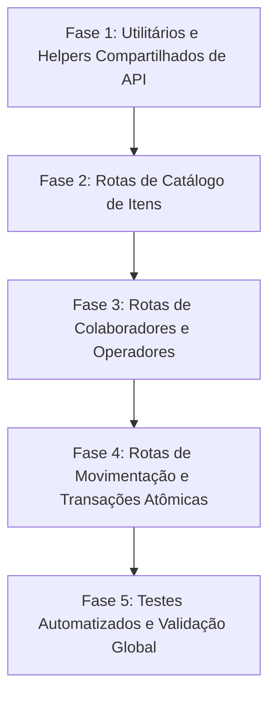

# Plano de Implementação: Rotas de API no Backend Next.js (BFF)

## 1. Objetivo e Contexto

Este plano estabelece a construção da camada de **Route Handlers no Next.js App Router** (`src/web/app/api/`), expondo a lógica do Core e a persistência atômica do Firestore através de uma API REST estruturada, segura e fortemente tipada.

A API atuará como o **BFF (Backend for Frontend)** seguro tanto para a aplicação Web (Next.js) quanto para o futuro aplicativo móvel (Expo/React Native), garantindo autenticação via Firebase Auth, autorização RBAC baseada em papéis (`mestre`, `admin`, `operador`, `requisitante`) e validação estrita com Zod.

---

## 2. Princípios de Arquitetura e Segurança

1. **Backend Confiável e RBAC:**
   - Toda rota que altera estoque ou lê dados sensíveis exige token de autenticação via header `Authorization: Bearer <token>`.
   - Permissões checadas via `hasUserPermission`:
     - `stock:operate`: para baixas, entradas e ajustes de estoque (`mestre`, `admin`, `operador`).
     - `catalog:manage`: para criação e alteração de cadastro de materiais e colaboradores (`mestre`, `admin`).
     - `users:read` / `users:create`: restrito a usuários administrativos (`mestre`).
2. **Delegação ao Core e ao Repositório Transacional:**
   - As rotas não contêm regras de negócio duplicadas; elas orquestram a entrada HTTP, validam schemas Zod e delegam para `MovimentacaoService` e `FirestoreEstoqueRepository`.
3. **Respostas e Erros Padronizados:**
   - Sucesso com dados tipados JSON (200 OK, 201 Created).
   - Erros Zod retornam 400 Bad Request com detalhes dos campos violados.
   - Falhas de autenticação retornam 401 Unauthorized.
   - Permissão insuficiente retorna 403 Forbidden.
   - Erros de negócio (`ItemNaoEncontradoError`, `SaldoInsuficienteError`, `LoteEstoqueInsuficienteError`) retornam códigos HTTP semânticos (404, 422 Unprocessable Entity).

---

## 3. Mapeamento de Rotas

| Método | Caminho | Permissão Requerida | Descrição |
| :--- | :--- | :--- | :--- |
| **GET** | `/api/itens` | `signedIn` | Lista catálogo de itens com paginação e filtros (busca, tipo, statusEstoque). |
| **POST** | `/api/itens` | `catalog:manage` | Cria um novo item no catálogo (`CreateItemSchema`). |
| **GET** | `/api/itens/[id]` | `signedIn` | Detalha um item por ID único. |
| **PATCH** | `/api/itens/[id]` | `catalog:manage` | Atualiza dados cadastrais de um item (`UpdateItemSchema`). |
| **GET** | `/api/itens/codigo/[codigo]` | `signedIn` | Busca rápida de item por código padronizado (ex: `90-1105`). |
| **GET** | `/api/colaboradores` | `signedIn` | Lista colaboradores com filtros (setor, ativos, busca textual). |
| **POST** | `/api/colaboradores` | `catalog:manage` | Cadastra novo colaborador (`CreateColaboradorSchema`). |
| **GET** | `/api/colaboradores/[id]` | `signedIn` | Detalha colaborador por ID. |
| **PATCH** | `/api/colaboradores/[id]` | `catalog:manage` | Atualiza dados cadastrais de colaborador (`UpdateColaboradorSchema`). |
| **GET** | `/api/colaboradores/matricula/[matricula]` | `signedIn` | Busca colaborador por matrícula normalizada (ex: `042`). |
| **POST** | `/api/movimentacoes/baixa-lote` | `stock:operate` | **Baixa rápida atômica** em lote com detecção de concorrência. |
| **POST** | `/api/movimentacoes/entrada` | `stock:operate` | Registro de entrada de mercadorias por compra ou produção. |
| **POST** | `/api/movimentacoes/baixa-interna` | `stock:operate` | Registro de baixa avulsa para consumo de colaborador. |
| **POST** | `/api/movimentacoes/expedicao` | `stock:operate` | Registro de saída para cliente / expedição. |
| **POST** | `/api/movimentacoes/ajuste` | `stock:operate` | Ajuste compensatório de inventário. |
| **GET** | `/api/movimentacoes/extrato/[itemId]` | `signedIn` | Extrato histórico ordenado de um item específico. |
| **GET** | `/api/movimentacoes` | `signedIn` | Histórico global de movimentações paginado com filtros. |

---

## 4. Fases Sequenciais de Implementação

---

### Fase 1: Utilitários Compartilhados de API (`src/web/app/api/api-helpers.ts`)
> **Objetivo:** Centralizar helpers de parsing, autenticação, verificação de permissões RBAC e tratamento unificado de erros para todas as rotas da aplicação.

- **Micro-tarefas:**
  - [x] **1.1** Criar `src/web/app/api/api-helpers.ts`:
    - `requireIdentity(request)`: valida token Bearer e extrai identidade do usuário.
    - `requirePermission(identity, permission)`: valida permissão RBAC (`stock:operate`, `catalog:manage`, etc.).
    - `readJson<T>(request)`: extração segura com erro amigável se JSON inválido.
    - `toErrorResponse(error)`: tratamento centralizado de `ZodError`, `ApiError`, `AuthorizationError`, `SaldoInsuficienteError`, `LoteEstoqueInsuficienteError`, etc.
  - [x] **1.2** Criar fábrica de injeção de dependência para instanciar repositório e serviços no contexto da requisição (`getEstoqueService()`).

---

### Fase 2: Rotas do Catálogo de Itens (`/api/itens`)
> **Objetivo:** Expor operações de catálogo para busca, detalhamento e manutenção de materiais.

- **Micro-tarefas:**
  - [x] **2.1** Criar `src/web/app/api/itens/route.ts`:
    - `GET`: parsing de `ItemFiltrosSchema` a partir dos searchParams e chamada a `repo.listarComFiltros()`.
    - `POST`: validação com `CreateItemSchema`, verificação de permissão `catalog:manage` e chamada a `repo.salvarItem()`.
  - [x] **2.2** Criar `src/web/app/api/itens/[id]/route.ts`:
    - `GET`: busca item por ID (`repo.buscarItemPorId`).
    - `PATCH`: atualização cadastral com `UpdateItemSchema`.
  - [x] **2.3** Criar `src/web/app/api/itens/codigo/[codigo]/route.ts`:
    - `GET`: busca direta por código padronizado com retorno 404 se não encontrado.

---

### Fase 3: Rotas de Colaboradores (`/api/colaboradores`)
> **Objetivo:** Expor endpoints para validação rápida de operadores autorizados na retirada de materiais.

- **Micro-tarefas:**
  - [x] **3.1** Criar `src/web/app/api/colaboradores/route.ts`:
    - `GET`: filtros de colaboradores por setor, busca e status ativo.
    - `POST`: cadastro com `CreateColaboradorSchema` e verificação de matrícula duplicada.
  - [x] **3.2** Criar `src/web/app/api/colaboradores/[id]/route.ts`:
    - `GET`: busca colaborador por ID.
    - `PATCH`: atualização de colaborador com `UpdateColaboradorSchema`.
  - [x] **3.3** Criar `src/web/app/api/colaboradores/matricula/[matricula]/route.ts`:
    - `GET`: busca direta por matrícula normalizada para suporte a leitores de código de barras ou bipagem.

---

### Fase 4: Rotas de Movimentações e Transações Atômicas (`/api/movimentacoes`)
> **Objetivo:** Expor as operações de movimentação física de estoque com integridade ACID estrita.

- **Micro-tarefas:**
  - [x] **4.1** Criar `src/web/app/api/movimentacoes/baixa-lote/route.ts`:
    - `POST`: validação com `RegistrarBaixaLoteSchema`, permissão `stock:operate` e chamada a `movimentacaoService.executarBaixaLote()`.
    - Retorno 422 Unprocessable Entity com payload detalhado caso haja `LoteEstoqueInsuficienteError`.
  - [x] **4.2** Criar `src/web/app/api/movimentacoes/entrada/route.ts`:
    - `POST`: validação com `RegistrarEntradaSchema` e chamada a `movimentacaoService.executarEntrada()`.
  - [x] **4.3** Criar `src/web/app/api/movimentacoes/baixa-interna/route.ts`, `expedicao/route.ts` e `ajuste/route.ts`.
  - [x] **4.4** Criar `src/web/app/api/movimentacoes/extrato/[itemId]/route.ts` e `/api/movimentacoes/route.ts` para consulta de extrato e histórico auditado.

---

### Fase 5: Testes Automatizados e Validação Global
> **Objetivo:** Garantir cobertura e estabilidade das rotas com testes de integração e validação de segurança.

- **Micro-tarefas:**
  - [ ] **5.1** Criar testes automatizados para os route handlers cobrindo autenticação, autorização (401/403) e validação Zod (400).
  - [ ] **5.2** Criar testes de integração da rota `/api/movimentacoes/baixa-lote` validando transação atômica e rollback em caso de saldo insuficiente.
  - [ ] **5.3** Executar `npm run typecheck` e `npm test` garantindo conformidade de 100%.

---

## 5. Próximo Passo Imediato

Iniciar pela **Fase 5**: consolidação de testes automatizados, validação global de segurança e build do BFF.
