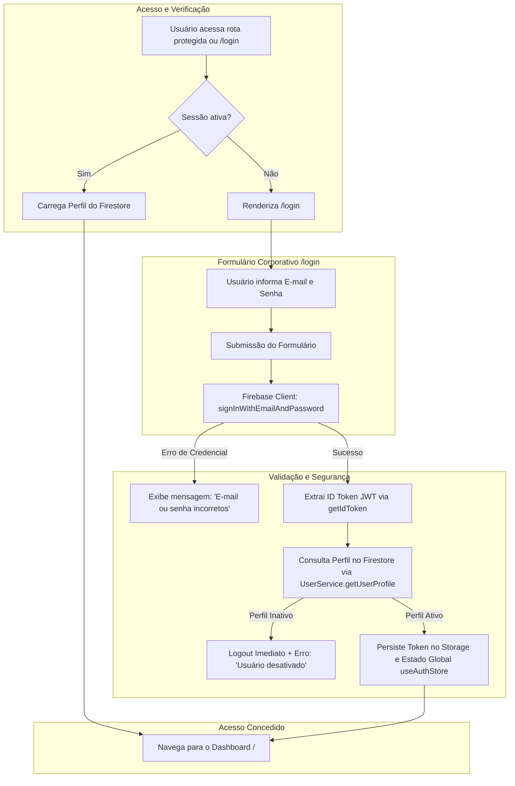

# Plano de Implementação: Autenticação e Tela de Login Corporativa

## 1. Visão Geral e Objetivo

Este documento estabelece o plano técnico e de design para a implementação da **Tela de Login e Fluxo de Autenticação** do Sistema de Almoxarifado.

A aplicação passará a contar com um ponto de entrada seguro antes do painel operacional ([`src/web/app/page.tsx`](file:///c:/Users/Eduardo/Desktop/exemplo/sistema_almoxarifado/src/web/app/page.tsx)), garantindo que apenas colaboradores previamente cadastrados acessem as operações e recursos do estoque.

### Principais Diretrizes:
1. **Design Minimalista & Corporativo**: Alinhado à densidade de sistemas de missão crítica (ERP/SaaS operacional) e às convenções em [`.cursorrules`](file:///c:/Users/Eduardo/Desktop/exemplo/sistema_almoxarifado/.cursorrules). Sem clichês de landing page, sem cantos arredondados excessivos, paleta neutra com acento azul corporativo (`--sidebar-bg: #12303f` e `--brand: #0f5c7a`).
2. **Exclusividade de Contas Existentes (Zero Auto-Cadastro)**: Não haverá opção de "Criar conta", "Cadastrar-se" ou "Registro público". Apenas o **Usuário Mestre** possui autorização e interfaces para criar contas e atribuir papéis no sistema.
3. **Gestão de Sessão e Token JWT**: Autenticação direta com o Firebase Auth Client, recuperação do token JWT (`getIdToken`), verificação de integridade no Firestore (`users/{uid}` com checagem de `ativo: true`), e propagação automática do cabeçalho `Authorization: Bearer <token>` para o cliente HTTP ([`src/core/api/client.ts`](file:///c:/Users/Eduardo/Desktop/exemplo/sistema_almoxarifado/src/core/api/client.ts)).

---

## 2. Arquitetura e Fluxo de Autenticação



---

## 3. Diretrizes de Design & UX (Minimalista Corporativo)

Em total concordância com as regras de frontend do projeto ([`.cursorrules`](file:///c:/Users/Eduardo/Desktop/exemplo/sistema_almoxarifado/.cursorrules)):

| Elemento | Especificação Corporativa | Justificativa / Anti-Clichê |
| :--- | :--- | :--- |
| **Layout Central** | Container limpo (`max-w-md`), centralizado vertical e horizontalmente em tela inteira. | Foco total na tarefa de login, sem ilustrações distrativas ou carrosséis promocionais. |
| **Paleta de Cores** | Superfície `bg-white dark:bg-[#17212a]`, borda sutil `border-slate-200 dark:border-slate-800`, fundo do app `#f1f4f8 dark:#0c1218`. | Consistente com a paleta do dashboard operacional. |
| **Campos de Entrada** | Labels técnicas acima do input (`text-xs font-semibold text-slate-700 dark:text-slate-300 uppercase tracking-wider`). Altura `h-10`, borda sutil, foco com anel no tom da marca (`#0f5c7a`). | Clareza e precisão na digitação das credenciais. |
| **Toggle de Senha** | Ícone discreto (`Eye` / `EyeOff`) embutido no final do campo de senha. | Praticidade corporativa para conferência de digitação. |
| **Botão de Ação** | Botão sóbrio e primário: `bg-[#0f5c7a] hover:bg-[#0c4b64] text-white font-medium text-sm h-10 rounded-lg`. | Ação direta sem gradientes chamativos de landing page. |
| **Feedback de Erro** | Banner compacto com fundo semântico sutil (`bg-rose-50 dark:bg-rose-950/40 border border-rose-200 dark:border-rose-900 text-rose-700 dark:text-rose-300 text-xs`). | Mensagens objetivas, sem popups invasivos. |
| **Alternância de Tema** | Integrado ao [`ThemeToggle`](file:///c:/Users/Eduardo/Desktop/exemplo/sistema_almoxarifado/src/web/components/layout/ThemeToggle.tsx) existente, posicionado de forma discreta no canto superior direito. | Permite operação em ambientes com baixa luminosidade ou chão de fábrica. |
| **Rodapé Institucional** | Nota de rodapé em `text-xs text-slate-500`: *"Acesso restrito e monitorado. A criação e liberação de acessos é gerenciada pelo Usuário Mestre."* | Reforça a governança e elimina dúvidas sobre auto-cadastro. |

---

## 4. Estrutura de Arquivos e Componentização

```text
src/
├── core/
│   ├── store/
│   │   ├── useAuthStore.ts                 # Store Zustand: user, token, role, login(), logout(), initAuth()
│   │   └── index.ts                        # Export centralizado dos stores
│   └── services/
│       └── firebase.ts                     # Instância cliente do Firebase Auth existente
└── web/
    ├── app/
    │   ├── login/
    │   │   └── page.tsx                    # Rota de login Next.js (página corporativa centrada)
    │   ├── page.tsx                        # Dashboard principal protegido por sessão
    │   └── layout.tsx                      # Layout base da aplicação
    └── components/
        └── auth/
            ├── LoginForm.tsx               # Formulário operacional de autenticação
            └── AuthGuard.tsx               # Componente Guardião de rotas autenticadas
```

---

## 5. Cronograma e Etapas de Execução

### Etapa 1: Gerenciamento Global de Autenticação (`useAuthStore`)
- [ ] Criar a store Zustand [`useAuthStore.ts`](file:///c:/Users/Eduardo/Desktop/exemplo/sistema_almoxarifado/src/core/store/useAuthStore.ts):
  * **Estado**: `user: User | null`, `token: string | null`, `isLoading: boolean`, `error: string | null`, `isAuthenticated: boolean`.
  * **Ações**:
    * `login(email, password)`: Realiza `signInWithEmailAndPassword`, busca o perfil no Firestore via `UserService.getUserProfile(uid)`, verifica se o usuário está ativo (`user.ativo === true`), obtém o token JWT e salva no `localStorage` sob a chave `auth_token`.
    * `logout()`: Efetua `signOut(auth)`, limpa o token do storage e redefine o estado.
    * `initializeAuth()`: Registra listener `onAuthStateChanged` para restaurar automaticamente a sessão e atualizar o token silenciosamente.
  * Conectar o token ao interceptor do [`createApiClient`](file:///c:/Users/Eduardo/Desktop/exemplo/sistema_almoxarifado/src/core/api/client.ts).

### Etapa 2: Componente do Formulário de Login (`LoginForm`)
- [ ] Criar [`src/web/components/auth/LoginForm.tsx`](file:///c:/Users/Eduardo/Desktop/exemplo/sistema_almoxarifado/src/web/components/auth/LoginForm.tsx):
  * Campos:
    * **E-mail Corporativo**: input com ícone `Mail`, validação de preenchimento, autocomplete apropriado (`email`).
    * **Senha**: input com ícone `Lock`, alternância de visibilidade (`Eye` / `EyeOff`), autocomplete (`current-password`).
  * Estado de carregamento no botão (`Entrando...` com `Loader2` animado).
  * Mapeamento de erros do Firebase para mensagens corporativas claras:
    * `auth/invalid-credential`, `auth/wrong-password`, `auth/user-not-found` → *"E-mail ou senha incorretos."*
    * `auth/user-disabled` → *"Conta desativada pelo administrador."*
    * `auth/too-many-requests` → *"Muitas tentativas malsucedidas. Aguarde alguns instantes."*
    * Usuário com `ativo === false` no Firestore → *"Acesso bloqueado: usuário desativado pela administração."*

### Etapa 3: Página de Login (`/login`)
- [ ] Criar [`src/web/app/login/page.tsx`](file:///c:/Users/Eduardo/Desktop/exemplo/sistema_almoxarifado/src/web/app/login/page.tsx):
  * Identidade visual limpa com cabeçalho de boas-vindas corporativo (logo do almoxarifado, título e subtítulo institucional).
  * Botão de alternância de tema [`ThemeToggle`](file:///c:/Users/Eduardo/Desktop/exemplo/sistema_almoxarifado/src/web/components/layout/ThemeToggle.tsx) no topo da tela.
  * Rodapé com selo de conformidade: *"Acesso restrito. Não possui acesso? Contate o Administrador Mestre."*
  * Redirecionamento automático caso o usuário já possua sessão ativa válida.

### Etapa 4: Proteção de Rotas com `AuthGuard`
- [ ] Criar [`src/web/components/auth/AuthGuard.tsx`](file:///c:/Users/Eduardo/Desktop/exemplo/sistema_almoxarifado/src/web/components/auth/AuthGuard.tsx):
  * Monitora o estado de autenticação.
  * Durante a checagem inicial, renderiza um indicador minimalista de carregamento corporativo (skeleton sutil de tela cheia).
  * Se não autenticado, redireciona para `/login`.
  * Se autenticado, libera o conteúdo filho.
- [ ] Integrar o `AuthGuard` no dashboard principal ([`src/web/app/page.tsx`](file:///c:/Users/Eduardo/Desktop/exemplo/sistema_almoxarifado/src/web/app/page.tsx)).
- [ ] Exibir no cabeçalho ou menu lateral do dashboard o nome do usuário logado e opção de encerrar sessão (*Logout*).

### Etapa 5: Validação e Testes
- [ ] Teste unitário e de fluxo para o `useAuthStore` (login bem-sucedido, credenciais inválidas, bloqueio de usuário inativo).
- [ ] Teste de navegação: acesso a rotas privadas redirecionando para `/login`.
- [ ] Teste de persistência: recarregar a página mantém a sessão e o token ativos sem deslogar.
- [ ] Verificação de responsividade (desktop, tablet e mobile).

---

## 6. Critérios de Aceite

1. **Segurança de Acesso**: Nenhuma página do dashboard ou operação de estoque pode ser acessada sem token válido emitido pelo Firebase.
2. **Governança de Usuários**: A tela de login não disponibiliza qualquer mecanismo de auto-criação de contas.
3. **Padrão Estético**: A tela respeita rigorosamente as diretrizes corporativas em `.cursorrules`, com harmonia nos modos claro e escuro.
4. **Resiliência e Clareza**: Mensagens de erro são precisas, discretas e orientam o usuário sem expor detalhes internos do sistema.
